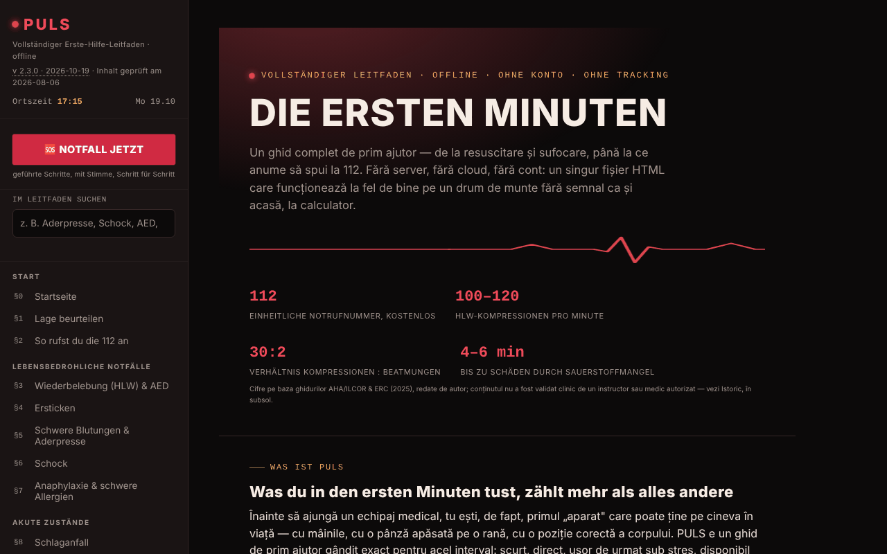

# PULS

[English](README.md) · [Română](README.ro.md) · [Français](README.fr.md) · [Italiano](README.it.md) · [Español](README.es.md) · [Português](README.pt.md) · **Deutsch** · [Magyar](README.hu.md)

**Version:** 2.5.0 · **Zuletzt aktualisiert:** 2026-10-28

Oberflächensprachen: **Română, English, Français, Italiano, Español, Português (PT), Deutsch, Magyar**

Vollständiger Erste-Hilfe-Leitfaden in einer einzigen HTML-Datei.

**Online-App:** https://chiuta.github.io/PULS/

## Was es ist

PULS (v2.3.2 in der Anwendung, aktualisiert am 2026-10-19; der medizinische Inhalt wurde zuletzt am 2026-08-06 geprüft und nicht klinisch erneut verifiziert) ist ein Erste-Hilfe-Leitfaden in 8 Sprachen mit 32 Abschnitten und einem „Notfallmodus“, der dich Schritt für Schritt, mit Sprachausgabe, durch die Handgriffe führt. Der Inhalt ist als Bildungsinhalt deklariert, vom Autor auf Grundlage der Leitlinien von ERC, AHA/ILCOR und WHO wiedergegeben, **ohne klinische Validierung durch einen zugelassenen Ausbilder oder Arzt**, und er **ersetzt nicht** einen zugelassenen Kurs, ärztlichen Rat oder professionelles Eingreifen; im echten Notfall wird die 112 angerufen.

**Sprachen:** der gesamte Leitfaden (Schritte, Absätze, Hinweise, der Test mit rund 96 Fragen, Glossar, die Schritte des Notfallmodus und die Sprachführung, Verlauf, Haftungshinweis) sowie Titel und Beschreibung der Seite liegen in den 8 Sprachen vor; der exportierte Text der Notfallkarte (QR/PNG/Druck), die kopierte Triage-Zusammenfassung, deine eigenen Eingaben (einschließlich der Zeilen „Allergien:/Medikation:“ und der eigenen Nachricht) und Eigennamen (TelVerde, 112, SMURD) bleiben unverändert. Die Übersetzungen sind automatisch und nicht von Muttersprachlern geprüft; **alle übersetzten medizinischen Inhalte (HLW/AED, Ersticken, Blutung/Abbinden, Schock, Anaphylaxie, Schlaganfall, Herzinfarkt, Krampfanfälle, Unterzuckerung, Unterkühlung, Verbrennungen, Vergiftungen, Traumata, Pädiatrie, psychologische Erste Hilfe, Test, Glossar, Notfallmodus) müssen von einem Arzt oder einem autorisierten Ausbilder geprüft werden**, besonders die Dosen und Zeiten (Aspirin 300 mg, 20 min Kühlung, 15–20 min Augenspülung, 5–6 cm, 100–120/min); in der Quelle ist „tabletă necoptă“ mit „uncoated“ wiedergegeben, vermutlich ein zu prüfender Fehler. Die App ersetzt weder einen Kurs noch den Anruf unter 112.

## Funktionen

- **Abschnitte (§0–§31):** Lagebeurteilung, wie man die 112 anruft, Herz-Lungen-Wiederbelebung und AED, Verschlucken, Blutungen und Tourniquet, Schock, Anaphylaxie, Schlaganfall, Herzinfarkt, Krampfanfälle, Unterzuckerung, Unterkühlung, Hitzschlag, Ertrinken, Vergiftungen, Verbrennungen, Stromunfall, Knochenbrüche, Schädel-Hirn-Verletzungen, Wunden, Augenverletzungen, Bisse und Stiche, stabile Seitenlage, Verbandkasten, meine Notfallkarte, Triage, Notsignalisierung, Erste Hilfe bei Kindern und psychologische Erste Hilfe, Wissenstest, Glossar A–Z.
- **🆘 NOTFALL JETZT:** geführter Modus, mit Schritten und Sprachsynthese (speechSynthesis des Browsers, wo vorhanden).
- HLW-Metronom mit Ton und Vibration, Wechsel-Timer für Helfer, Rhythmus-Rückmeldung über den Beschleunigungssensor, Tourniquet-Timer.
- Meine Notfallkarte (Blutgruppe, Allergien, Erkrankungen, Medikation, Kontakt) mit `.json`-Export/-Import und lokaler QR-Code-Erzeugung; die Daten personalisieren die Warnhinweise im Notfallmodus.
- START-Triage mit Verletztenliste, Notsignalisierung (Sirene, SOS-Morsezeichen, Stroboskop, Blitz wo unterstützt), Aktivierung des Notfallmodus durch Schütteln des Telefons (DeviceMotion).
- Schaltflächen „112 anrufen“, „Meinen Standort senden“ (Geolokalisierung + Web Share), „Nächstes Krankenhaus“.
- **Suche im Leitfaden** (Seitenleiste): durchsucht den Volltext der 32 Abschnitte ohne diakritische Zeichen (z. B. „garou“, „musc“), filtert das Menü; Enter öffnet den am besten passenden Abschnitt, Esc leert das Feld.
- Wissenstest (bis zu zehn Fragen pro Runde), Nacht-/Tag-Design (beim ersten Öffnen folgt es der Systemeinstellung „hell/dunkel“), Drucken des aktuellen Abschnitts, Schaltfläche „Fehler melden“ (mailto).

## Neue Funktionen (v2.2.0, 14. Oktober 2026)

**Der medizinische Inhalt (die 32 Abschnitte, die Schritte im Notfallmodus, die Werte und die Warnhinweise) hat sich nicht geändert**; automatisch geprüft: Der Text der Abschnitte ist identisch mit dem der v2.1.4, bis auf eine in §25 hinzugefügte Schaltfläche.

### Haptisches Feedback
- Kurze, unterscheidbare Vibrationen bei Oberflächenaktionen im Notfallmodus: Öffnen, Auswahl der Situation, nächster Schritt, vorheriger Schritt, letzter Schritt, „Das Team ist eingetroffen“ und Drücken von „112 anrufen“. Schalter im linken Menü und in der Leiste des Notfallmodus (📳); die Auswahl wird in `localStorage` gespeichert (Schlüssel `puls-haptic-v1`). Standardmäßig aktiv, wo der Browser `navigator.vibrate` bietet; ohne die API sind die Schalter ausgeblendet.
- Die bestehenden **funktionalen** Vibrationen (HLW-Metronom, SOS-Signalisierung, Timer-Warnungen) hängen nicht von diesem Schalter ab und sind unverändert geblieben.
- **Grenze:** iOS/Safari bietet die Vibration API nicht, daher ist dort nichts zu spüren; auf manchen Telefonen ist die Vibration in den Systemeinstellungen deaktiviert.

### Notfall-QR-Karte im Vollbild
- Die Schaltfläche „QR-Karte im Vollbild“ (in §25) öffnet einen Dialog mit einem großen QR-Code (mit einer von Lesegeräten verlangten Ruhezone von 4 Modulen) und darunter dem Text der Karte, damit sie auch ohne Scannen gelesen werden kann; sie lässt sich auch vom Bildschirm „Das Team ist eingetroffen“ aus öffnen. Wir halten den Bildschirm eingeschaltet, solange der Dialog geöffnet ist (wo `Wake Lock` existiert). Optionen: Speichern als PNG und Drucken (nur die Karte).
- **Korrektur:** Die QR-Kodierung verwendete Latin-1, sodass rumänische diakritische Zeichen (ă, ș, ț) im erzeugten Code beschädigt wurden; der Text wird jetzt als UTF-8 kodiert (durch Dekodieren mit einem externen Lesegerät geprüft). Auch der kleine Code auf der Seite hat jetzt eine Ruhezone und eine größere Darstellung.
- **Datenschutz:** Der Code und die PNG-Datei enthalten die Daten der Karte **im Klartext**; jeder, der das Bild scannt, kann sie lesen. Behandle die Datei wie ein persönliches medizinisches Dokument. Nichts verlässt den Browser.
- **Grenze:** Es gibt keine Garantie, dass jedes Gerät den Code liest; die QR-Kapazität ist begrenzt (sehr lange Felder können die Kapazität überschreiten, und die Anwendung zeigt dann eine Meldung).

### Transparenz und Sicherungskopie (fff-kit)

Ein Klick (oder Enter) auf die angezeigte Version (`v 2.2.0 · 2026-10-14`) öffnet das Fenster „Transparenz“: die deklarierten Netzwerk-Hosts (0 externe Anfragen), die Schlüssel des lokalen Speichers mit Größen, die verwendeten APIs, Größe und SHA-256 der Datei (mit einem Prüfer für eine heruntergeladene Datei) und die **Sicherungskopie** der Anwendungsdaten in einer `.fff.json`-Datei (optional per Passwort verschlüsselt, AES-GCM 256 / PBKDF2; das Passwort kann nicht wiederhergestellt werden), Import mit Bestätigung und Löschen der Anwendungsdaten. Das Kit (`fff-kit`, Module: core, label, bundle) ist in `index.html` eingefügt, stellt keine Netzwerkanfragen und ändert keine vorhandenen Daten; ohne es funktioniert die Anwendung genauso. Achtung: Die Sicherungskopie des Kits enthält, wenn du das Behalten auf dem Gerät angekreuzt hast, **auch deine Notfallkarte** (`puls-card-v1`, persönliche medizinische Daten). Verwende die Option „Verschlüsselt exportieren“, wenn die Datei gespeichert oder verschickt wird. Die Texte des Kits liegen in 8 Sprachen vor (ro, en, fr, it, es, pt, hu, de); **die Übersetzungen fr/it/es/pt/hu/de sind maschinell erstellt und nicht von Muttersprachlern geprüft**. Oberfläche und Inhalt der App liegen ebenfalls in den 8 Sprachen vor (siehe den Sprachhinweis am Anfang); die Inhaltsübersetzungen sind automatisch und nicht von Muttersprachlern geprüft.

## Anleitung

1. Öffne die Seite; navigiere mit dem Menü links (oder ☰ auf Mobilgeräten).
2. Drücke im Notfall **🆘 NOTFALL JETZT**, wähle die Situation und folge den Schritten („Nächster Schritt →“, „← Zurück“). Die Schaltfläche „📞 JETZT 112 ANRUFEN“ startet den Anruf. `Esc` schließt den Modus.
3. Öffne für die HLW den §3 und starte das Metronom (Ton/Vibration); folge den Hinweisen auf dem Bildschirm.
4. In §2 fragt „📍 Meinen Standort senden“ nach der Standortberechtigung; „🏥 Nächstes Krankenhaus“ öffnet die Karte des Telefons.
5. Fülle „Meine Notfallkarte“ (§25) aus, solange du ruhig bist; „💾 Exportieren (.json)“ speichert die Karte, „📂 Importieren“ stellt sie wieder her, „▦ QR-Code erzeugen“ erstellt einen Code, der von jedem QR-Leser gelesen werden kann.
6. Wechsle das Design mit „☾ Nacht“ / „☀ Tag“; „🖨️ Aktuellen Abschnitt drucken“ druckt den Abschnitt.
7. Übe mit §30 Wissenstest; suche Begriffe in §31 Glossar.

## Datenschutz und Netzwerk

- **Lokaler Speicher:** Die einzige Verwendung von `localStorage` (Schlüssel `puls-card-v1`) ist die optionale Kopie der Notfallkarte, aktiv nur, wenn du „Karte auf diesem Gerät behalten“ ankreuzt; ohne Häkchen bleibt die Karte nur im Speicher der Seite (exportiere sie in eine Datei, um sie nicht zu verlieren). Keine IndexedDB-Aufrufe.
- **Lokaler Speicher (Ergänzung v2.2.0):** Der Schlüssel `puls-haptic-v1` speichert nur die Wahl des haptischen Feedbacks (`0`/`1`).
- **Netzwerk:** Es gibt kein `fetch` und keine von anderen Websites geladenen Ressourcen; die QR-Bibliothek ist in der Datei enthalten. Die einzigen Ausgänge aus der Seite sind vom Nutzer ausgelöste Links/Aktionen: Google Maps (`maps.google.com`, `google.com/maps`) für Krankenhaus/Apotheke und den geteilten Standort, der Anruf `tel:112`, `mailto:`, dazu Links zu Quellen (crucearosie.ro, cpr.heart.org, erc.edu, who.int, smurd.ro, antisuicid.ro, buymeacoffee.com, trom.tf, chiuta.github.io).
- Die Anwendung erklärt: keine Cookies, keine Analyse.

## Lokale Ausführung / offline

Lade `index.html` herunter und öffne sie in einem Browser; der Leitfaden funktioniert ohne Internet. Nur die Schaltflächen für Karte/Krankenhaus und das Teilen des Standorts benötigen eine Verbindung und die Apps des Geräts.

## Lizenz

MIT — siehe die Datei `LICENSE`. © 2026 Alexandru-Ionuț Chiuță (Alexio). Die in der Datei enthaltenen Bibliotheken von Drittanbietern behalten ihre eigenen Lizenzen (zum Beispiel der QR-Code-Generator von Kazuhiko Arase, MIT).

## Audit

Audit: 2026-10-10 — geprüft mit Playwright und axe-core (WCAG 2.1 AA, beide Designs); im Code geprüft: kein `fetch`, kein `localStorage`. Korrigiert: das Menü/Layout für schmale Bildschirme (die CSS-Regeln für ☰ fehlten), der Farbkontrast. Der medizinische Inhalt wurde nur durchgesehen, nicht klinisch validiert — für eine Überprüfung frage den Rat eines zugelassenen Spezialisten/Ausbilders ein.

## Verlauf / Changelog

### 2.3.5 — 2026-10-22

fff-kit 1.1.4: Touch-Ziele und Mindestschriftgröße; Touch-Ziele und Text korrigiert.
- 2.3.4 — 2026-10-22: fff-kit 1.1.2: PBKDF2 mit 600.000 Iterationen, Schutz vor Clickjacking
- 2.3.3 — 2026-10-22: Barrierefreiheit: genau eine H1 auf der Seite (der Startseitentitel ist ein H2-Element, das als Ebene 1 angekündigt wird; das Aussehen bleibt gleich). Mobil: Aller Text hat mindestens 12 px; Links in der Fußzeile und der Schalter „ältere Versionen“ haben eine größere Tippfläche; die NOTFALL-Schaltflächen sind mindestens 44-48 px hoch.
- 2.3.2 — 2026-10-19: der gesamte Leitfaden, der Test, das Glossar, der Notfallmodus und die Sprachführung sind nach en, fr, it, es, pt, de, hu übersetzt (rund 1.180 neue Schlüssel); in 2.3.2 folgen auch Seitentitel und Meta-Beschreibung der Sprache. Der Satz „bleibt auf Rumänisch“ wurde entfernt. Die medizinischen Inhalte müssen von einem Arzt oder einem autorisierten Ausbilder geprüft werden.
- 2.2.0 — 2026-10-14: optionales haptisches Feedback für die Schritte im Notfallmodus; Notfall-QR-Karte im Vollbild (PNG, Drucken); QR für diakritische Zeichen repariert (UTF-8); fff-kit (Transparenz + Sicherungskopie). Medizinischer Inhalt unverändert.

- 2.1.4 — 2026-10-12: Version und Datum der letzten Aktualisierung werden in der Anwendung angezeigt (medizinischer Inhalt unverändert).

v2.1.3 (11. Oktober 2026):
- Obere Leiste auf Mobilgeräten: Die Schaltfläche ☰ zeigt jetzt auch den Text „Menü“ (zuvor nur ein Symbol); der Text wird unter 340 px ausgeblendet.
- Meine Notfallkarte: optionales Kästchen „Karte auf diesem Gerät behalten“ (standardmäßig aus; die Daten gehen nur in den `localStorage` dieses Browsers, mit Warnung für gemeinsam genutzte Geräte; das Abwählen löscht die Kopie) und Schaltfläche „Karte löschen“. Ohne Häkchen bleibt die Karte nur im Speicher, wie bisher; der `.json`-Export/-Import ist unverändert.
- CSP-Hashes neu berechnet; axe-core = 0 Verstöße bei 1280 und 360 px.

v2.1.2 (11. Oktober 2026):
- Suche im gesamten Leitfaden in der Seitenleiste; das anfängliche Design folgt `prefers-color-scheme`; der Hero-Bereich des ersten Abschnitts hat auf Bildschirmen ≤ 900 px 16 px Ränder (zuvor 44 px Innenabstand, der Text blieb bei 360 px etwa 240 px breit). CSP-Hash neu berechnet; axe-core = 0 Verstöße bei 1280 und 360 px, in beiden Designs.

v2.1.1 (11. Oktober 2026):
- Seitenränder von 16 px auf Bildschirmen ≤ 900 px (zuvor 44 px, was den Text bei 360 px verengte).
- Barrierefreiheit: Die obere Leiste ist ein `<header>`, die Überschriften der Fußzeile sind h2 (richtige Reihenfolge); axe-core = 0 Verstöße bei 1280 und 360 px.
- CSP-Richtlinie (`<meta>`) hinzugefügt: Skripte nur per Hash, `connect-src 'none'`.
- Die Lizenz bleibt nicht festgelegt (Entscheidung des Autors).

## Autor

Alexio — Alexandru-Ionuț Chiuță, Kontakt: alexio@trom.tf

## Zusammenfassung

PULS ist ein 8-sprachiger Erste-Hilfe-Leitfaden in einer einzigen HTML-Datei: 32 Abschnitte, ein sprachgeführter Notfallmodus, HLW-Metronom, Tourniquet-Timer, Notfallkarte mit lokalem QR-Code, START-Triage und Notsignalisierung. Keine fetch-Aufrufe; localStorage nur, wenn du dich dafür entscheidest, die Notfallkarte auf dem Gerät zu behalten; die Schaltflächen für Karte/Krankenhaus öffnen externe Dienste nur beim Klick. Bildungsinhalt, kein Ersatz für eine zertifizierte Ausbildung oder den Anruf der Notrufnummer.
