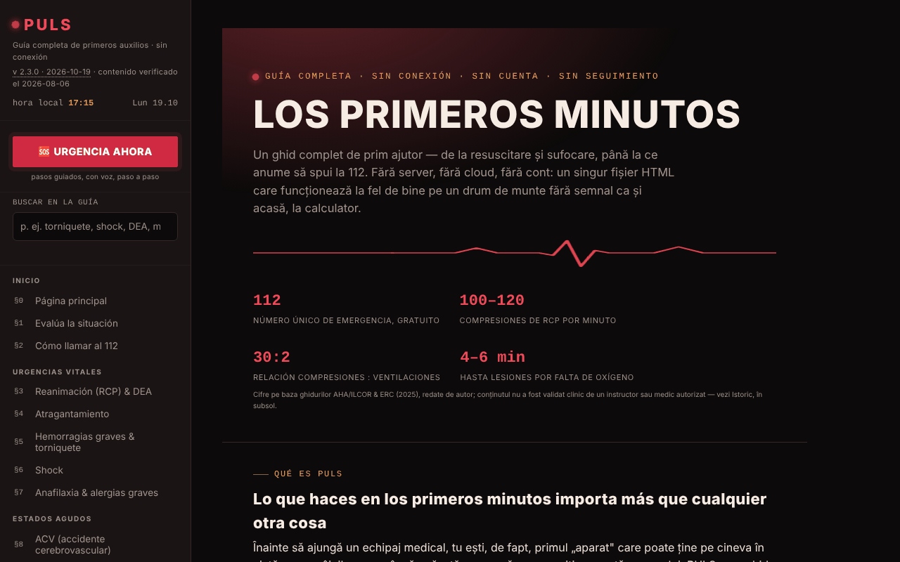

# PULS

[English](README.md) · [Română](README.ro.md) · [Français](README.fr.md) · [Italiano](README.it.md) · **Español** · [Português](README.pt.md) · [Deutsch](README.de.md) · [Magyar](README.hu.md)

**Versión:** 2.3.4 · **Última actualización:** 2026-10-22

Idiomas de la interfaz: **Română, English, Français, Italiano, Español, Português (PT), Deutsch, Magyar**

Guía completa de primeros auxilios, en un único archivo HTML.

**Aplicación en línea:** https://chiuta.github.io/PULS/

## Qué es

PULS (v2.3.2 en la aplicación, actualizada el 2026-10-19; el contenido médico se comprobó por última vez el 2026-08-06 y no se ha vuelto a verificar clínicamente) es una guía de primeros auxilios en 8 idiomas, con 32 secciones y un «Modo Urgencia» que te guía paso a paso, con voz, a través de las maniobras. El contenido se declara educativo, redactado por el autor a partir de las guías del ERC, de la AHA/ILCOR y de la OMS, **sin validación clínica por parte de un instructor o médico autorizado**, y **no sustituye** a un curso autorizado, al dictamen médico ni a la intervención profesional; en una urgencia real, se llama al 112.

**Idiomas:** toda la guía (pasos, párrafos, notas, test de unas 96 preguntas, glosario, pasos del Modo Emergencia y guía por voz, historial, aviso), así como el título y la descripción de la página están disponibles en los 8 idiomas; el texto exportado de la tarjeta de emergencia (QR/PNG/impresión), el resumen de triaje copiado, los datos que introduces (incluidas las líneas «Alergias:/Medicación:» y el mensaje personalizado) y los nombres propios (TelVerde, 112, SMURD) permanecen sin cambios. Las traducciones son automáticas, no verificadas por hablantes nativos; **todo el contenido médico traducido (RCP/DEA, atragantamiento, hemorragia/torniquete, shock, anafilaxia, ictus, infarto, convulsiones, hipoglucemia, hipotermia, quemaduras, intoxicaciones, traumatismos, pediatría, primeros auxilios psicológicos, test, glosario, Modo Emergencia) requiere revisión por un médico o un instructor autorizado**, en especial las dosis y duraciones (aspirina 300 mg, 20 min de enfriamiento, 15–20 min de lavado ocular, 5–6 cm, 100–120/min); en la fuente «tabletă necoptă» aparece como «uncoated», probablemente un error por comprobar. La aplicación no sustituye un curso ni la llamada al 112.

## Funciones

- **Secciones (§0–§31):** evaluación de la situación, cómo llamar al 112, RCP y DEA, atragantamiento, hemorragias y torniquete, shock, anafilaxia, ictus, infarto, convulsiones, hipoglucemia, hipotermia, golpe de calor, ahogamiento, intoxicaciones, quemaduras, electrocución, fracturas, traumatismos craneoencefálicos, heridas, traumatismos oculares, mordeduras y picaduras, posición lateral de seguridad, botiquín de primeros auxilios, mi tarjeta de emergencia, triaje, señalización de emergencia, primeros auxilios pediátricos y psicológicos, prueba de conocimientos, glosario A–Z.
- **🆘 URGENCIA AHORA:** modo guiado, con pasos y síntesis de voz (speechSynthesis del navegador, donde exista).
- Metrónomo de RCP con sonido y vibración, cronómetro de relevo de los socorristas, retroalimentación del ritmo desde el acelerómetro, cronómetro del torniquete.
- Mi tarjeta de emergencia (grupo sanguíneo, alergias, afecciones, medicación, contacto) con exportación/importación `.json` y generación local de código QR; los datos personalizan las advertencias del Modo Urgencia.
- Triaje START con lista de víctimas, señalización de emergencia (sirena, SOS en morse, estroboscopio, flash donde sea compatible), activación del Modo Urgencia agitando el teléfono (DeviceMotion).
- Botones «Llamar al 112», «Enviar mi ubicación» (geolocalización + Web Share), «Hospital más cercano».
- **Búsqueda en la guía** (barra lateral): busca en el texto completo de las 32 secciones, sin diacríticos (p. ej. «garou», «musc»), filtra el menú; Intro abre la sección más adecuada, Esc vacía el campo.
- Prueba de conocimientos (hasta diez preguntas por ronda), tema Noche/Día (en la primera apertura sigue la preferencia del sistema «claro/oscuro»), impresión de la sección actual, botón «Informar de un error» (mailto).

## Novedades (v2.2.0, 14 de octubre de 2026)

**El contenido médico (las 32 secciones, los pasos del Modo Urgencia, los valores y las advertencias) no ha cambiado**; comprobado automáticamente: el texto de las secciones es idéntico al de la v2.1.4, salvo un botón añadido en el §25.

### Retroalimentación háptica
- Vibraciones cortas y distintas en las acciones de interfaz del Modo Urgencia: apertura, elección de la situación, paso siguiente, paso anterior, último paso, «Ha llegado el equipo» y pulsación de «Llamar al 112». Conmutador en el menú izquierdo y en la barra del Modo Urgencia (📳); la elección se conserva en `localStorage` (clave `puls-haptic-v1`). Activado por defecto donde el navegador ofrece `navigator.vibrate`; sin la API, los conmutadores se ocultan.
- Las vibraciones **funcionales** existentes (metrónomo de RCP, señalización SOS, alertas de los cronómetros) no dependen de este conmutador y han permanecido sin cambios.
- **Límite:** iOS/Safari no ofrece la API de vibración, así que allí no se siente nada; en algunos teléfonos la vibración está desactivada en los ajustes del sistema.

### Tarjeta QR de emergencia a pantalla completa
- El botón «Tarjeta QR a pantalla completa» (en el §25) abre un diálogo con un código QR grande (con zona de silencio de 4 módulos, exigida por los lectores) y con el texto de la tarjeta debajo, para que también se pueda leer sin escanear; también se puede abrir desde la pantalla «Ha llegado el equipo». Mantenemos la pantalla encendida mientras el diálogo está abierto (donde existe `Wake Lock`). Opciones: guardado como PNG e impresión (solo la tarjeta).
- **Corrección:** la codificación del QR usaba Latin-1, por lo que los diacríticos rumanos (ă, ș, ț) se estropeaban en el código generado; ahora el texto se codifica en UTF-8 (verificado decodificando con un lector externo). También el código pequeño de la página tiene ahora zona de silencio y mayor tamaño.
- **Privacidad:** el código y el PNG contienen los datos de la tarjeta **en claro**; cualquiera que escanee la imagen los lee. Trata el archivo como un documento médico personal. Nada sale del navegador.
- **Límite:** no hay garantía de que cualquier aparato lea el código; la capacidad del QR es limitada (campos muy largos pueden superar la capacidad y la aplicación muestra un mensaje).

### Transparencia y copia de seguridad (fff-kit)

Un clic (o Intro) en la versión mostrada (`v 2.2.0 · 2026-10-14`) abre la ventana «Transparencia»: los hosts de red declarados (0 peticiones externas), las claves de almacenamiento local con sus tamaños, las API utilizadas, el tamaño y el SHA-256 del archivo (con un verificador para un archivo descargado) y la **copia de seguridad** de los datos de la aplicación en un archivo `.fff.json` (opcionalmente cifrado con contraseña, AES-GCM 256 / PBKDF2; la contraseña no se puede recuperar), la importación con confirmación y el borrado de los datos de la aplicación. El kit (`fff-kit`, módulos: core, label, bundle) está pegado en `index.html`, no hace peticiones de red y no cambia los datos existentes; sin él la aplicación funciona igual. Atención: la copia de seguridad del kit contiene, si has marcado la conservación en el dispositivo, **también tu tarjeta de emergencia** (`puls-card-v1`, datos médicos personales). Usa la opción «Exportar cifrado» si el archivo se va a almacenar o enviar. Los textos del kit están en 8 idiomas (ro, en, fr, it, es, pt, hu, de); **las traducciones fr/it/es/pt/hu/de son automáticas y no están verificadas por hablantes nativos**. La interfaz y el contenido de la aplicación también están disponibles en los 8 idiomas (véase la nota sobre idiomas al principio); las traducciones del contenido son automáticas, no verificadas por hablantes nativos.

## Manual de uso

1. Abre la página; navega con el menú izquierdo (o ☰ en móvil).
2. En una urgencia, pulsa **🆘 URGENCIA AHORA**, elige la situación y sigue los pasos («Paso siguiente →», «← Atrás»). El botón «📞 LLAMAR AL 112 AHORA» inicia la llamada. `Esc` cierra el modo.
3. Para la RCP, abre el §3 y pon en marcha el metrónomo (sonido/vibración); sigue las indicaciones en pantalla.
4. En el §2, «📍 Enviar mi ubicación» pide permiso de ubicación; «🏥 Hospital más cercano» abre el mapa del teléfono.
5. Rellena «Mi tarjeta de emergencia» (§25) mientras estés tranquilo; «💾 Exportar (.json)» guarda la tarjeta, «📂 Importar» la restaura, «▦ Generar código QR» crea un código legible por cualquier lector de QR.
6. Cambia el tema con «☾ Noche» / «☀ Día»; «🖨️ Imprimir la sección actual» imprime la sección.
7. Practica con el §30 Prueba de conocimientos; busca términos en el §31 Glosario.

## Privacidad y red

- **Almacenamiento local:** el único uso de `localStorage` (clave `puls-card-v1`) es la copia opcional de la tarjeta de emergencia, activa solo si marcas «Conservar la tarjeta en este dispositivo»; sin la marca, la tarjeta permanece solo en la memoria de la página (expórtala a un archivo para no perderla). Ninguna llamada a IndexedDB.
- **Almacenamiento local (adición v2.2.0):** la clave `puls-haptic-v1` conserva solo la elección de la retroalimentación háptica (`0`/`1`).
- **Red:** no hay `fetch` ni recursos cargados desde otros sitios; la biblioteca QR está incluida en el archivo. Las únicas salidas de la página son enlaces/acciones iniciados por el usuario: Google Maps (`maps.google.com`, `google.com/maps`) para hospital/farmacia y la ubicación compartida, la llamada `tel:112`, `mailto:`, además de enlaces a fuentes (crucearosie.ro, cpr.heart.org, erc.edu, who.int, smurd.ro, antisuicid.ro, buymeacoffee.com, trom.tf, chiuta.github.io).
- La aplicación declara: sin cookies, sin analítica.

## Ejecución local / sin conexión

Descarga `index.html` y ábrelo en un navegador; la guía funciona sin internet. Solo los botones de mapa/hospital y el uso compartido de la ubicación necesitan conexión y las aplicaciones del dispositivo.

## Licencia

MIT — véase el archivo `LICENSE`. © 2026 Alexandru-Ionuț Chiuță (Alexio). Las bibliotecas de terceros incluidas en el archivo conservan sus propias licencias (por ejemplo, el generador de códigos QR de Kazuhiko Arase, MIT).

## Auditoría

Auditoría: 2026-10-10 — comprobado con Playwright y axe-core (WCAG 2.1 AA, ambos temas); comprobado en el código: sin `fetch`, sin `localStorage`. Corregidos: el menú/diseño para pantallas estrechas (faltaban las reglas CSS para ☰), el contraste de los colores. El contenido médico solo fue revisado, no validado clínicamente — para su verificación, solicita el dictamen de un especialista/instructor autorizado.

## Historial / Registro de cambios
- 2.3.4 — 2026-10-22: fff-kit 1.1.2: PBKDF2 con 600.000 iteraciones, protección anti-clickjacking
- 2.3.3 — 2026-10-22: Accesibilidad: un solo H1 en la página (el título de inicio es un elemento de nivel 2 anunciado como nivel 1; el aspecto no cambia). Móvil: todo el texto pasa a un mínimo de 12 px; los enlaces del pie y el conmutador «versiones anteriores» tienen un área táctil mayor; los botones URGENCIA miden al menos 44-48 px de alto.
- 2.3.2 — 2026-10-19: toda la guía, el test, el glosario, el Modo Emergencia y la guía por voz están traducidos a en, fr, it, es, pt, de, hu (unas 1180 claves nuevas); en la 2.3.2 también el título y la meta descripción de la página siguen el idioma. Se eliminó la frase «sigue en rumano». El contenido médico requiere revisión por un médico o un instructor autorizado.
- 2.2.0 — 2026-10-14: retroalimentación háptica opcional para los pasos del Modo Urgencia; tarjeta QR de emergencia a pantalla completa (PNG, impresión); QR corregido para los diacríticos (UTF-8); fff-kit (Transparencia + copia de seguridad). Contenido médico sin cambios.

- 2.1.4 — 2026-10-12: la versión y la fecha de la última actualización se muestran en la aplicación (contenido médico sin cambios).

v2.1.3 (11 de octubre de 2026):
- Barra superior en móvil: el botón ☰ muestra ahora también el texto «Menú» (antes solo un icono); el texto se oculta por debajo de 340 px.
- Mi tarjeta de emergencia: casilla opcional «Conservar la tarjeta en este dispositivo» (desactivada por defecto; los datos van solo al `localStorage` de este navegador, con una advertencia para dispositivos compartidos; al desmarcarla se borra la copia) y botón «Borrar la tarjeta». Sin la marca, la tarjeta permanece solo en memoria, como hasta ahora; la exportación/importación `.json` no cambia.
- Hashes CSP recalculados; axe-core = 0 infracciones a 1280 y 360 px.

v2.1.2 (11 de octubre de 2026):
- Búsqueda en toda la guía en la barra lateral; el tema inicial sigue `prefers-color-scheme`; el hero de la primera sección tiene márgenes de 16 px en pantallas ≤ 900 px (antes 44 px de relleno interno, el texto quedaba de unos 240 px de ancho a 360 px). Hash CSP recalculado; axe-core = 0 infracciones a 1280 y 360 px, en ambos temas.

v2.1.1 (11 de octubre de 2026):
- Márgenes laterales de 16 px en pantallas ≤ 900 px (antes 44 px, lo que estrechaba el texto a 360 px).
- Accesibilidad: la barra superior es un `<header>`, los títulos del pie de página son h2 (orden correcto); axe-core = 0 infracciones a 1280 y 360 px.
- Añadida una política CSP (`<meta>`): scripts solo por hash, `connect-src 'none'`.
- La licencia sigue sin declarar (decisión del autor).

## Autor

Alexio — Alexandru-Ionuț Chiuță, contacto: alexio@trom.tf

## Resumen

PULS es una guía de primeros auxilios en 8 idiomas en un único archivo HTML: 32 secciones, un Modo Urgencia guiado por voz, metrónomo de RCP, cronómetro de torniquete, tarjeta de emergencia con código QR local, triaje START y señalización de emergencia. Sin llamadas fetch; localStorage solo si decides conservar la tarjeta de emergencia en el dispositivo; los botones de mapa/hospital abren servicios externos solo al hacer clic. Contenido educativo, no sustituye a una formación certificada ni a llamar al número de emergencias.
