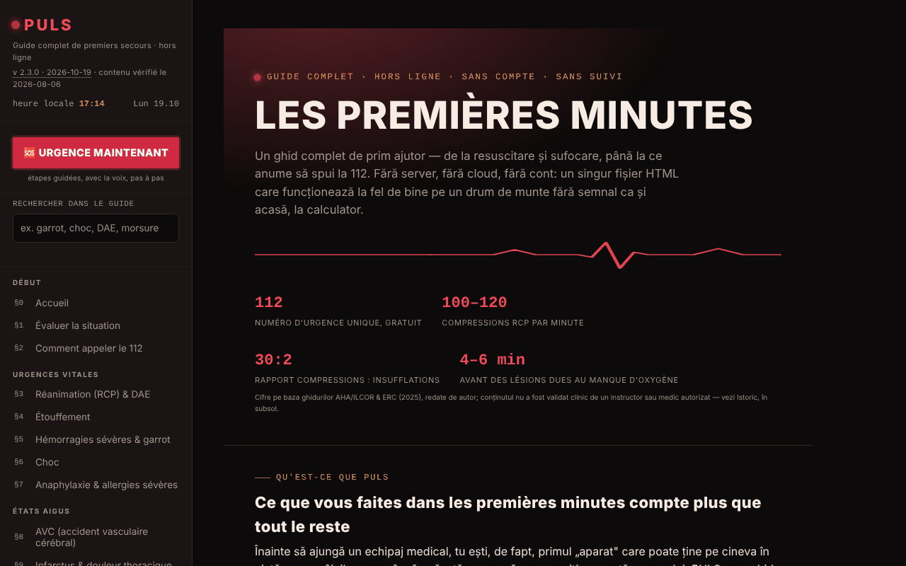

# PULS

[English](README.md) · [Română](README.ro.md) · **Français** · [Italiano](README.it.md) · [Español](README.es.md) · [Português](README.pt.md) · [Deutsch](README.de.md) · [Magyar](README.hu.md)

**Version :** 2.5.0 · **Dernière mise à jour :** 2026-10-28

Langues de l'interface : **Română, English, Français, Italiano, Español, Português (PT), Deutsch, Magyar**

Guide complet de premiers secours, dans un seul fichier HTML.

**Application en ligne :** https://chiuta.github.io/PULS/

## Présentation

PULS (v2.3.2 dans l'application, mise à jour le 2026-10-19 ; le contenu médical a été vérifié pour la dernière fois le 2026-08-06 et n'a pas fait l'objet d'une nouvelle vérification clinique) est un guide de premiers secours en 8 langues, avec 32 sections et un « Mode Urgence » qui vous guide pas à pas, avec la voix, à travers les gestes. Le contenu est déclaré éducatif, rédigé par l'auteur à partir des lignes directrices de l'ERC, de l'AHA/ILCOR et de l'OMS, **sans validation clinique par un formateur ou un médecin agréé**, et il **ne remplace pas** une formation agréée, un avis médical ou une intervention professionnelle ; en cas d'urgence réelle, appelez le 112.

**Langues :** tout le guide (étapes, paragraphes, notes, test d'environ 96 questions, glossaire, étapes du Mode Urgence et guidage vocal, historique, avertissement), ainsi que le titre et la description de la page sont disponibles dans les 8 langues ; le texte exporté de la carte d'urgence (QR/PNG/impression), le résumé de triage copié, les données que vous saisissez (y compris les lignes « Allergies :/Médication : » et le message personnalisé) et les noms propres (TelVerde, 112, SMURD) restent tels quels. Les traductions sont automatiques, non vérifiées par des locuteurs natifs ; **tout le contenu médical traduit (RCP/DAE, étouffement, hémorragie/garrot, choc, anaphylaxie, AVC, infarctus, convulsions, hypoglycémie, hypothermie, brûlures, intoxications, traumatismes, pédiatrie, premiers secours psychologiques, test, glossaire, Mode Urgence) doit être relu par un médecin ou un instructeur agréé**, en particulier les doses et durées (aspirine 300 mg, 20 min de refroidissement, 15–20 min de rinçage des yeux, 5–6 cm, 100–120/min) ; dans la source, « tabletă necoptă » est rendu par « uncoated », probablement une erreur à vérifier. L'application ne remplace ni une formation ni un appel au 112.

## Fonctionnalités

- **Sections (§0–§31) :** évaluation de la situation, comment appeler le 112, RCP et DAE, étouffement, hémorragies et garrot, choc, anaphylaxie, AVC, infarctus, convulsions, hypoglycémie, hypothermie, coup de chaleur, noyade, intoxications, brûlures, électrocution, fractures, traumatismes crânio-cérébraux, plaies, traumatismes oculaires, morsures et piqûres, position latérale de sécurité, trousse de premiers secours, ma carte d'urgence, triage, signalisation d'urgence, premiers secours pédiatriques et psychologiques, test de connaissances, glossaire A–Z.
- **🆘 URGENCE MAINTENANT :** mode guidé, avec étapes et synthèse vocale (speechSynthesis du navigateur, lorsqu'elle existe).
- Métronome de RCP avec son et vibration, minuteur de rotation des sauveteurs, retour sur le rythme à partir de l'accéléromètre, minuteur de garrot.
- Ma carte d'urgence (groupe sanguin, allergies, affections, médicaments, contact) avec export/import `.json` et génération locale de code QR ; les données personnalisent les avertissements du Mode Urgence.
- Triage START avec liste de victimes, signalisation d'urgence (sirène, SOS en morse, stroboscope, flash là où c'est pris en charge), activation du Mode Urgence en secouant le téléphone (DeviceMotion).
- Boutons « Appeler le 112 », « Envoyer ma position » (géolocalisation + Web Share), « Hôpital le plus proche ».
- **Recherche dans le guide** (barre latérale) : cherche dans le texte intégral des 32 sections, sans diacritiques (p. ex. « garou », « musc »), filtre le menu ; Entrée ouvre la section la plus pertinente, Échap vide le champ.
- Test de connaissances (jusqu'à dix questions par manche), thème Nuit/Jour (à la première ouverture, il suit la préférence système « clair/sombre »), impression de la section en cours, bouton « Signaler une erreur » (mailto).

## Nouveautés (v2.2.0, 14 octobre 2026)

**Le contenu médical (les 32 sections, les étapes du Mode Urgence, les valeurs et les avertissements) n'a pas changé** ; vérifié automatiquement : le texte des sections est identique à celui de la v2.1.4, à l'exception d'un bouton ajouté au §25.

### Retour haptique
- Vibrations courtes et distinctes lors des actions d'interface du Mode Urgence : ouverture, choix de la situation, étape suivante, étape précédente, dernière étape, « L'équipe est arrivée » et appui sur « Appeler le 112 ». Commutateur dans le menu de gauche et dans la barre du Mode Urgence (📳) ; le choix est conservé dans `localStorage` (clé `puls-haptic-v1`). Activé par défaut partout où le navigateur propose `navigator.vibrate` ; sans l'API, les commutateurs sont masqués.
- Les vibrations **fonctionnelles** existantes (métronome de RCP, signalisation SOS, alertes des minuteurs) ne dépendent pas de ce commutateur et sont restées inchangées.
- **Limite :** iOS/Safari ne propose pas l'API Vibration, donc rien ne se ressent sur ces appareils ; sur certains téléphones, la vibration est désactivée dans les réglages du système.

### Carte QR d'urgence en plein écran
- Le bouton « Carte QR en plein écran » (au §25) ouvre une boîte de dialogue avec un grand code QR (avec une zone de silence de 4 modules, exigée par les lecteurs) et le texte de la carte en dessous, afin qu'elle puisse aussi être lue sans scan ; elle peut aussi être ouverte depuis l'écran « L'équipe est arrivée ». L'écran reste allumé tant que la boîte de dialogue est ouverte (là où `Wake Lock` existe). Options : enregistrement en PNG et impression (la carte uniquement).
- **Correction :** l'encodage QR utilisait le Latin-1, de sorte que les diacritiques roumains (ă, ș, ț) étaient corrompus dans le code généré ; le texte est désormais encodé en UTF-8 (vérifié par décodage avec un lecteur externe). Le petit code de la page a lui aussi désormais une zone de silence et une taille plus grande.
- **Confidentialité :** le code et le PNG contiennent les données de la carte **en clair** ; quiconque scanne l'image les lit. Traitez le fichier comme un document médical personnel. Rien ne quitte le navigateur.
- **Limite :** rien ne garantit que tout appareil lise le code ; la capacité du QR est limitée (des champs très longs peuvent dépasser la capacité et l'application affiche alors un message).

### Transparence et sauvegarde (fff-kit)

Un clic (ou Entrée) sur la version affichée (`v 2.2.0 · 2026-10-14`) ouvre la fenêtre « Transparence » : les hôtes réseau déclarés (0 requête externe), les clés de stockage local avec leurs tailles, les API utilisées, la taille et le SHA-256 du fichier (avec un vérificateur pour un fichier téléchargé) et la **sauvegarde** des données de l'application dans un fichier `.fff.json` (éventuellement chiffré par mot de passe, AES-GCM 256 / PBKDF2 ; le mot de passe est irrécupérable), l'import avec confirmation et la suppression des données de l'application. Le kit (`fff-kit`, modules : core, label, bundle) est intégré dans `index.html`, ne fait aucune requête réseau et ne modifie pas les données existantes ; sans lui, l'application fonctionne de la même façon. Attention : la sauvegarde du kit contient, si vous avez coché la conservation sur l'appareil, **aussi votre carte d'urgence** (`puls-card-v1`, données médicales personnelles). Utilisez l'option « Exporter chiffré » si le fichier doit être stocké ou envoyé. Les textes du kit sont en 8 langues (ro, en, fr, it, es, pt, hu, de) ; **les traductions fr/it/es/pt/hu/de sont automatiques et non vérifiées par des locuteurs natifs**. L'interface et le contenu de l'application sont aussi disponibles dans les 8 langues (voir la note sur les langues en haut) ; les traductions du contenu sont automatiques, non vérifiées par des locuteurs natifs.

## Mode d'emploi

1. Ouvrez la page ; naviguez avec le menu de gauche (ou ☰ sur mobile).
2. En cas d'urgence, appuyez sur **🆘 URGENCE MAINTENANT**, choisissez la situation et suivez les étapes (« Étape suivante → », « ← Retour »). Le bouton « 📞 APPELER LE 112 MAINTENANT » lance l'appel. `Échap` ferme le mode.
3. Pour la RCP, ouvrez le §3 et lancez le métronome (son/vibration) ; suivez les indications à l'écran.
4. Au §2, « 📍 Envoyer ma position » demande l'autorisation de localisation ; « 🏥 Hôpital le plus proche » ouvre la carte du téléphone.
5. Remplissez « Ma carte d'urgence » (§25) pendant que vous êtes calme ; « 💾 Exporter (.json) » enregistre la carte, « 📂 Importer » la restaure, « ▦ Générer un code QR » crée un code lisible par n'importe quel lecteur de QR.
6. Changez le thème avec « ☾ Nuit » / « ☀ Jour » ; « 🖨️ Imprimer la section en cours » imprime la section.
7. Exercez-vous avec le §30 Test de connaissances ; cherchez des termes dans le §31 Glossaire.

## Confidentialité et réseau

- **Stockage local :** le seul usage de `localStorage` (clé `puls-card-v1`) est la copie facultative de la carte d'urgence, active uniquement si vous cochez « Conserver la carte sur cet appareil » ; sans cette case, la carte reste seulement dans la mémoire de la page (exportez-la dans un fichier pour ne pas la perdre). Aucun appel à IndexedDB.
- **Stockage local (ajout v2.2.0) :** la clé `puls-haptic-v1` conserve uniquement le choix du retour haptique (`0`/`1`).
- **Réseau :** il n'y a pas de `fetch` ni de ressources chargées depuis d'autres sites ; la bibliothèque QR est incluse dans le fichier. Les seules sorties de la page sont des liens/actions initiés par l'utilisateur : Google Maps (`maps.google.com`, `google.com/maps`) pour l'hôpital/la pharmacie et la position partagée, l'appel `tel:112`, `mailto:`, ainsi que des liens vers des sources (crucearosie.ro, cpr.heart.org, erc.edu, who.int, smurd.ro, antisuicid.ro, buymeacoffee.com, trom.tf, chiuta.github.io).
- L'application déclare : pas de cookies, pas d'analyse d'audience.

## Exécution locale / hors ligne

Téléchargez `index.html` et ouvrez-le dans un navigateur ; le guide fonctionne sans internet. Seuls les boutons de carte/hôpital et le partage de position ont besoin d'une connexion et des applications de l'appareil.

## Licence

MIT — voir le fichier `LICENSE`. © 2026 Alexandru-Ionuț Chiuță (Alexio). Les bibliothèques tierces incluses dans le fichier conservent leurs propres licences (par exemple le générateur de codes QR de Kazuhiko Arase, MIT).

## Audit

Audit : 2026-10-10 — vérifié avec Playwright et axe-core (WCAG 2.1 AA, les deux thèmes) ; vérifié dans le code : pas de `fetch`, pas de `localStorage`. Corrigés : le menu/la mise en page pour les écrans étroits (les règles CSS pour ☰ manquaient), le contraste des couleurs. Le contenu médical a seulement été parcouru, non validé cliniquement — pour une vérification, demandez l'avis d'un spécialiste/formateur agréé.

## Historique / Journal des modifications

### 2.3.5 — 2026-10-22

fff-kit 1.1.4 : cibles tactiles et taille de texte minimale; cibles tactiles et texte corrigés.
- 2.3.4 — 2026-10-22 : fff-kit 1.1.2 : PBKDF2 à 600 000 itérations, protection anti-clickjacking
- 2.3.3 — 2026-10-22: Accessibilité : un seul H1 dans la page (le titre de l'accueil est un élément de niveau 2 annoncé comme niveau 1 ; l'apparence est inchangée). Mobile : tout le texte passe à 12 px minimum ; les liens du pied de page et le bouton « versions antérieures » ont une zone tactile plus grande ; les boutons URGENCE font au moins 44-48 px de haut.
- 2.3.2 — 2026-10-19 : tout le guide, le test, le glossaire, le Mode Urgence et le guidage vocal sont traduits en en, fr, it, es, pt, de, hu (environ 1 180 nouvelles clés) ; en 2.3.2, le titre et la méta-description de la page suivent aussi la langue. La phrase « reste en roumain » a été supprimée. Le contenu médical doit être relu par un médecin ou un instructeur agréé.
- 2.2.0 — 2026-10-14 : retour haptique facultatif pour les étapes du Mode Urgence ; carte QR d'urgence en plein écran (PNG, impression) ; QR corrigé pour les diacritiques (UTF-8) ; fff-kit (Transparence + sauvegarde). Contenu médical inchangé.

- 2.1.4 — 2026-10-12 : la version et la date de dernière mise à jour sont affichées dans l'application (contenu médical inchangé).

v2.1.3 (11 octobre 2026) :
- Barre du haut sur mobile : le bouton ☰ affiche désormais aussi le texte « Menu » (auparavant seulement une icône) ; le texte est masqué en dessous de 340 px.
- Ma carte d'urgence : case facultative « Conserver la carte sur cet appareil » (désactivée par défaut ; les données vont uniquement dans le `localStorage` de ce navigateur, avec un avertissement pour les appareils partagés ; la décocher supprime la copie) et bouton « Supprimer la carte ». Sans la case cochée, la carte reste seulement en mémoire, comme auparavant ; l'export/import `.json` est inchangé.
- Hachages CSP recalculés ; axe-core = 0 violation à 1280 et 360 px.

v2.1.2 (11 octobre 2026) :
- Recherche dans tout le guide dans la barre latérale ; le thème initial suit `prefers-color-scheme` ; le bandeau d'accueil de la première section a des marges de 16 px sur les écrans ≤ 900 px (auparavant 44 px de remplissage interne, le texte restait large d'environ 240 px à 360 px). Hachage CSP recalculé ; axe-core = 0 violation à 1280 et 360 px, dans les deux thèmes.

v2.1.1 (11 octobre 2026) :
- Marges latérales de 16 px sur les écrans ≤ 900 px (auparavant 44 px, ce qui rétrécissait le texte à 360 px).
- Accessibilité : la barre du haut est un `<header>`, les titres du pied de page sont des h2 (ordre correct) ; axe-core = 0 violation à 1280 et 360 px.
- Ajout d'une politique CSP (`<meta>`) : scripts uniquement par hachage, `connect-src 'none'`.
- La licence reste non déclarée (décision de l'auteur).

## Auteur

Alexio — Alexandru-Ionuț Chiuță, contact : alexio@trom.tf

## Résumé

PULS est un guide de premiers secours en 8 langues, dans un seul fichier HTML : 32 sections, un Mode Urgence guidé par la voix, un métronome de RCP, un minuteur de garrot, une carte d'urgence avec code QR local, le triage START et la signalisation d'urgence. Aucun appel fetch ; localStorage uniquement si vous choisissez de conserver la carte d'urgence sur l'appareil ; les boutons de carte/hôpital n'ouvrent des services externes qu'au clic. Contenu éducatif, qui ne remplace ni une formation certifiée ni l'appel au numéro d'urgence.
