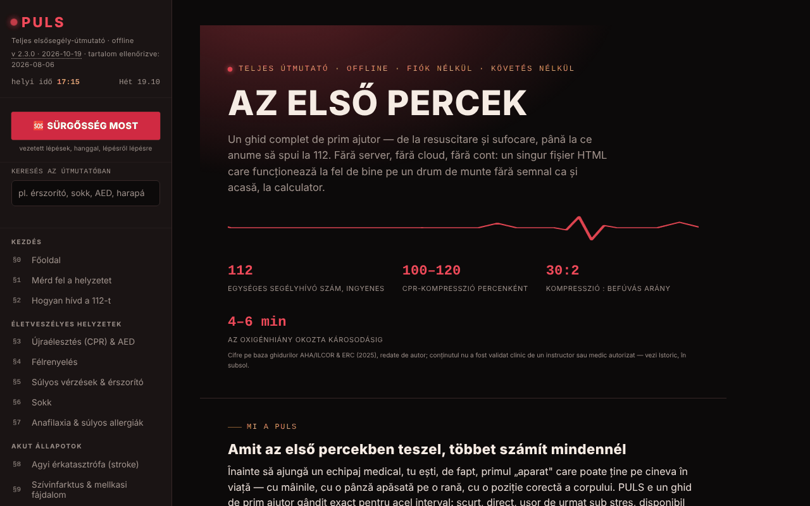

# PULS

[English](README.md) · [Română](README.ro.md) · [Français](README.fr.md) · [Italiano](README.it.md) · [Español](README.es.md) · [Português](README.pt.md) · [Deutsch](README.de.md) · **Magyar**

**Verzió:** 2.5.1 · **Utolsó frissítés:** 2026-10-28

A felület nyelvei: **Română, English, Français, Italiano, Español, Português (PT), Deutsch, Magyar**

Teljes elsősegély-útmutató egyetlen HTML-fájlban.

**Online alkalmazás:** https://chiuta.github.io/PULS/

## Mi ez

A PULS (v2.3.2 az alkalmazásban, frissítve 2026-10-19-én; az orvosi tartalmat utoljára 2026-08-06-án ellenőrizték, és klinikailag nem ellenőrizték újra) 8 nyelvű elsősegély-útmutató 32 szekcióval és egy „Vészhelyzet módddal”, amely lépésről lépésre, hanggal vezet végig a fogásokon. A tartalom oktatási jellegűnek van nyilvánítva, a szerző az ERC, az AHA/ILCOR és a WHO irányelvei alapján adta vissza, **hivatalosan képesített oktató vagy orvos általi klinikai jóváhagyás nélkül**, és **nem helyettesíti** a hivatalos tanfolyamot, az orvosi véleményt vagy a szakszerű beavatkozást; valódi vészhelyzetben a 112-t kell hívni.

**Nyelvek:** az egész útmutató (lépések, bekezdések, megjegyzések, a kb. 96 kérdéses teszt, szójegyzék, a Vészhelyzeti mód lépései és a hangos vezetés, előzmények, jogi nyilatkozat), valamint az oldal címe és leírása mind a 8 nyelven elérhető; a vészhelyzeti kártya exportált szövege (QR/PNG/nyomtatás), a kimásolt triázsösszegzés, az általad beírt adatok (beleértve az „Allergiák:/Gyógyszerek:” sorokat és az egyéni üzenetet) és a tulajdonnevek (TelVerde, 112, SMURD) változatlanul marad. A fordítások automatikusak, anyanyelvi beszélők nem ellenőrizték; **az összes lefordított orvosi tartalom (újraélesztés/AED, fulladás, vérzés/érszorító, sokk, anafilaxia, agyvérzés, szívinfarktus, görcsrohamok, hipoglikémia, kihűlés, égések, mérgezések, sérülések, gyermekgyógyászat, pszichológiai elsősegély, teszt, szójegyzék, Vészhelyzeti mód) orvosi vagy hivatalos oktatói felülvizsgálatot igényel**, különösen az adagok és időtartamok (aszpirin 300 mg, 20 perc hűtés, 15–20 perc szemöblítés, 5–6 cm, 100–120/perc); a forrásban a „tabletă necoptă” kifejezés „uncoated”-ként szerepel, valószínűleg ellenőrzendő hiba. Az alkalmazás nem helyettesít tanfolyamot vagy a 112 hívását.

## Funkciók

- **Szekciók (§0–§31):** a helyzet felmérése, hogyan hívd a 112-t, újraélesztés és AED, félrenyelés, vérzések és érszorító, sokk, anafilaxia, agyvérzés/stroke, szívinfarktus, görcsrohamok, hipoglikémia, hipotermia, hőguta, vízbefulladás, mérgezések, égési sérülések, áramütés, törések, koponya-agyi sérülések, sebek, szemsérülések, harapások és csípések, stabil oldalfekvés, elsősegély-doboz, az én vészhelyzeti kártyám, triázs, vészjelzés, gyermek- és pszichológiai elsősegély, tudáspróba, A–Z szójegyzék.
- **🆘 VÉSZHELYZET MOST:** vezetett mód lépésekkel és beszédszintézissel (a böngésző speechSynthesis szolgáltatása, ahol elérhető).
- Újraélesztési metronóm hanggal és rezgéssel, a mentők váltásának időzítője, ritmus-visszajelzés a gyorsulásmérőből, érszorító-időzítő.
- Az én vészhelyzeti kártyám (vércsoport, allergiák, betegségek, gyógyszerek, kapcsolattartó) `.json` exporttal/importtal és helyi QR-kód-generálással; az adatok személyre szabják a Vészhelyzet mód figyelmeztetéseit.
- START triázs sérültlistával, vészjelzés (sziréna, SOS Morse-jel, villogó fény, vaku ahol támogatott), a Vészhelyzet mód aktiválása a telefon megrázásával (DeviceMotion).
- „112 hívása”, „Helyzetem elküldése” (helymeghatározás + Web Share), „Legközelebbi kórház” gombok.
- **Keresés az útmutatóban** (oldalsáv): a 32 szekció teljes szövegében keres, ékezetek nélkül (pl. „garou”, „musc”), szűri a menüt; az Enter megnyitja a legjobban illeszkedő szekciót, az Esc kiüríti a mezőt.
- Tudáspróba (körönként legfeljebb tíz kérdés), Éjszaka/Nappal téma (az első megnyitáskor a rendszer „világos/sötét” beállítását követi), az aktuális szekció nyomtatása, „Hiba jelentése” gomb (mailto).

## Újdonságok (v2.2.0, 2026. október 14.)

**Az orvosi tartalom (a 32 szekció, a Vészhelyzet mód lépései, az értékek és a figyelmeztetések) nem változott**; automatikusan ellenőrizve: a szekciók szövege megegyezik a v2.1.4 szövegével, kivéve egy, a §25-be felvett gombot.

### Haptikus visszajelzés
- Rövid, megkülönböztethető rezgések a Vészhelyzet mód felületi műveleteinél: megnyitás, a helyzet kiválasztása, következő lépés, előző lépés, utolsó lépés, „Megérkezett a mentőcsapat” és a „112 hívása” megnyomása. Kapcsoló a bal oldali menüben és a Vészhelyzet mód sávjában (📳); a választás a `localStorage`-ban marad (kulcs: `puls-haptic-v1`). Alapértelmezés szerint be van kapcsolva, ahol a böngésző kínálja a `navigator.vibrate` függvényt; API nélkül a kapcsolók el vannak rejtve.
- A meglévő **funkcionális** rezgések (az újraélesztési metronóm, az SOS-jelzés, az időzítők riasztásai) nem függenek ettől a kapcsolótól, és változatlanok maradtak.
- **Korlát:** az iOS/Safari nem kínálja a Vibration API-t, ezért ott semmi sem érezhető; egyes telefonokon a rezgés ki van kapcsolva a rendszerbeállításokban.

### Teljes képernyős vészhelyzeti QR-kártya
- A „QR-kártya teljes képernyőn” gomb (a §25-ben) megnyit egy párbeszédablakot egy nagy QR-kóddal (az olvasók által megkövetelt 4 modul széles üres sávval), alatta a kártya szövegével, hogy beolvasás nélkül is olvasható legyen; megnyitható a „Megérkezett a mentőcsapat” képernyőről is. A képernyőt bekapcsolva tartjuk, amíg a párbeszédablak nyitva van (ahol van `Wake Lock`). Lehetőségek: mentés PNG-ként és nyomtatás (csak a kártya).
- **Javítás:** a QR-kódolás Latin-1-et használt, ezért a román ékezetes betűk (ă, ș, ț) elromlottak a generált kódban; a szöveg mostantól UTF-8-ként van kódolva (külső olvasóval történő dekódolással ellenőrizve). Az oldalon lévő kis kódnak is van már üres sávja és nagyobb mérete.
- **Adatvédelem:** a kód és a PNG a kártya adatait **olvasható szövegként** tartalmazza; bárki, aki beolvassa a képet, elolvashatja őket. Kezeld a fájlt személyes orvosi dokumentumként. Semmi sem hagyja el a böngészőt.
- **Korlát:** nincs garancia arra, hogy minden készülék beolvassa a kódot; a QR kapacitása korlátozott (a nagyon hosszú mezők meghaladhatják a kapacitást, és az alkalmazás üzenetet jelenít meg).

### Átláthatóság és biztonsági mentés (fff-kit)

A megjelenített verzióra (`v 2.2.0 · 2026-10-14`) kattintva (vagy Entert nyomva) megnyílik az „Átláthatóság” ablak: a deklarált hálózati gazdagépek (0 külső kérés), a helyi tárolás kulcsai méretekkel, a használt API-k, a fájl mérete és SHA-256 értéke (letöltött fájlhoz ellenőrzővel), valamint az alkalmazás adatainak **biztonsági mentése** egy `.fff.json` fájlba (opcionálisan jelszóval titkosítva, AES-GCM 256 / PBKDF2; a jelszó nem állítható vissza), importálás megerősítéssel és az alkalmazás adatainak törlése. A készlet (`fff-kit`, modulok: core, label, bundle) be van illesztve az `index.html` fájlba, nem küld hálózati kéréseket, és nem módosítja a meglévő adatokat; nélküle az alkalmazás ugyanúgy működik. Figyelem: a készlet biztonsági mentése – ha bejelölted az eszközön való megőrzést – **a vészhelyzeti kártyádat is** tartalmazza (`puls-card-v1`, személyes orvosi adatok). Ha a fájlt tárolni vagy elküldeni fogod, használd a „Titkosított exportálás” lehetőséget. A készlet szövegei 8 nyelven érhetők el (ro, en, fr, it, es, pt, hu, de); **az fr/it/es/pt/hu/de fordítások gépiek, és anyanyelvi beszélők nem ellenőrizték őket**. Az alkalmazás felülete és tartalma szintén elérhető a 8 nyelven (lásd az elején a nyelvi megjegyzést); a tartalom fordításai automatikusak, anyanyelvi beszélők nem ellenőrizték.

## Használati útmutató

1. Nyisd meg az oldalt; navigálj a bal oldali menüvel (mobilon a ☰ gombbal).
2. Vészhelyzetben nyomd meg a **🆘 VÉSZHELYZET MOST** gombot, válaszd ki a helyzetet, és kövesd a lépéseket („Következő lépés →”, „← Vissza”). A „📞 112 HÍVÁSA MOST” gomb elindítja a hívást. Az `Esc` bezárja a módot.
3. Újraélesztéshez nyisd meg a §3-at, és indítsd el a metronómot (hang/rezgés); kövesd a képernyőn megjelenő utasításokat.
4. A §2-ben a „📍 Helyzetem elküldése” helymeghatározási engedélyt kér; a „🏥 Legközelebbi kórház” megnyitja a telefon térképét.
5. Töltsd ki „Az én vészhelyzeti kártyámat” (§25), amíg nyugodt vagy; a „💾 Exportálás (.json)” menti a kártyát, a „📂 Importálás” visszaállítja, a „▦ QR-kód létrehozása” bármely QR-olvasóval olvasható kódot készít.
6. Váltsd a témát a „☾ Éjszaka” / „☀ Nappal” gombbal; a „🖨️ Az aktuális szekció nyomtatása” kinyomtatja a szekciót.
7. Gyakorolj a §30 Tudáspróbával; keress kifejezéseket a §31 Szójegyzékben.

## Adatvédelem és hálózat

- **Helyi tárolás:** a `localStorage` (kulcs: `puls-card-v1`) egyetlen felhasználása a vészhelyzeti kártya opcionális másolata, amely csak akkor aktív, ha bejelölöd a „Kártya megőrzése ezen az eszközön” lehetőséget; bejelölés nélkül a kártya csak az oldal memóriájában marad (exportáld fájlba, hogy ne veszítsd el). Nincsenek IndexedDB-hívások.
- **Helyi tárolás (v2.2.0 kiegészítés):** a `puls-haptic-v1` kulcs csak a haptikus visszajelzés választását tárolja (`0`/`1`).
- **Hálózat:** nincs `fetch`, és nincsenek más webhelyekről betöltött erőforrások; a QR-könyvtár a fájlban van. Az oldalról kivezető egyetlen út a felhasználó által indított hivatkozások/műveletek: a Google Maps (`maps.google.com`, `google.com/maps`) a kórházhoz/gyógyszertárhoz és a megosztott helyzethez, a `tel:112` hívás, a `mailto:`, valamint hivatkozások forrásokra (crucearosie.ro, cpr.heart.org, erc.edu, who.int, smurd.ro, antisuicid.ro, buymeacoffee.com, trom.tf, chiuta.github.io).
- Az alkalmazás kijelenti: nincsenek sütik, nincs elemzés.

## Helyi futtatás / offline

Töltsd le az `index.html` fájlt, és nyisd meg egy böngészőben; az útmutató internet nélkül is működik. Csak a térkép/kórház gombokhoz és a helyzet megosztásához kell kapcsolat és az eszköz alkalmazásai.

## Licenc

MIT — lásd a `LICENSE` fájlt. © 2026 Alexandru-Ionuț Chiuță (Alexio). A fájlban található harmadik féltől származó könyvtárak megtartják saját licencüket (például Kazuhiko Arase QR-kód-generátora, MIT).

## Audit

Audit: 2026-10-10 — Playwrighttal és axe-core-ral ellenőrizve (WCAG 2.1 AA, mindkét téma); kódban ellenőrizve: nincs `fetch`, nincs `localStorage`. Javítva: a menü/elrendezés keskeny képernyőkön (hiányoztak a ☰ CSS-szabályai), a színkontraszt. Az orvosi tartalmat csak átnéztük, klinikailag nem hagytuk jóvá — az ellenőrzéshez kérd ki egy hivatalosan képesített szakember/oktató véleményét.

## Előzmények / Változásnapló

### 2.3.5 — 2026-10-22

fff-kit 1.1.4: érintési célok és minimális szövegméret; érintési célok és szöveg javítva.
- 2.3.4 — 2026-10-22: fff-kit 1.1.2: PBKDF2 600 000 iterációval, clickjacking elleni védelem
- 2.3.3 — 2026-10-22: Akadálymentesség: pontosan egy H1 az oldalon (a kezdőlap címe 2. szintű elem, 1. szintűként felolvasva; a megjelenés nem változik). Mobil: minden szöveg legalább 12 px; a lábléc hivatkozásai és a „régebbi verziók” kapcsoló nagyobb érintési felületű; a SÜRGŐSSÉG gombok legalább 44-48 px magasak.
- 2.3.2 — 2026-10-19: az egész útmutató, a teszt, a szójegyzék, a Vészhelyzeti mód és a hangos vezetés le van fordítva en, fr, it, es, pt, de, hu nyelvre (kb. 1180 új kulcs); a 2.3.2-ben az oldal címe és meta leírása is követi a nyelvet. Eltávolítottuk a „románul marad” mondatot. Az orvosi tartalmat orvosnak vagy hivatalos oktatónak kell felülvizsgálnia.
- 2.2.0 — 2026-10-14: opcionális haptikus visszajelzés a Vészhelyzet mód lépéseihez; teljes képernyős vészhelyzeti QR-kártya (PNG, nyomtatás); QR-javítás az ékezetes betűkhöz (UTF-8); fff-kit (Átláthatóság + biztonsági mentés). Az orvosi tartalom változatlan.

- 2.1.4 — 2026-10-12: a verzió és az utolsó frissítés dátuma megjelenik az alkalmazásban (az orvosi tartalom változatlan).

v2.1.3 (2026. október 11.):
- Felső sáv mobilon: a ☰ gomb mostantól a „Menü” szöveget is mutatja (korábban csak ikon); a szöveg 340 px alatt el van rejtve.
- Az én vészhelyzeti kártyám: opcionális jelölőnégyzet „Kártya megőrzése ezen az eszközön” (alapértelmezés szerint kikapcsolva; az adatok csak ennek a böngészőnek a `localStorage`-ába kerülnek, közös eszközökre vonatkozó figyelmeztetéssel; a jelölés törlése törli a másolatot) és „Kártya törlése” gomb. Bejelölés nélkül a kártya csak a memóriában marad, ahogy eddig; a `.json` export/import változatlan.
- A CSP-hash-ek újraszámolva; axe-core = 0 szabálysértés 1280 és 360 px-nél.

v2.1.2 (2026. október 11.):
- Keresés az egész útmutatóban az oldalsávban; a kezdeti téma a `prefers-color-scheme` értéket követi; az első szekció hero-területének 16 px-es margói vannak ≤ 900 px-es képernyőkön (korábban 44 px belső margó, a szöveg 360 px-nél ~240 px széles maradt). CSP-hash újraszámolva; axe-core = 0 szabálysértés 1280 és 360 px-nél, mindkét témában.

v2.1.1 (2026. október 11.):
- 16 px-es oldalmargók ≤ 900 px-es képernyőkön (korábban 44 px, ami 360 px-nél leszűkítette a szöveget).
- Akadálymentesség: a felső sáv `<header>`, a lábléc címei h2-esek (helyes sorrend); axe-core = 0 szabálysértés 1280 és 360 px-nél.
- CSP-szabályzat hozzáadva (`<meta>`): szkriptek csak hash alapján, `connect-src 'none'`.
- A licenc továbbra sincs megadva (a szerző döntése).

## Szerző

Alexio — Alexandru-Ionuț Chiuță, kapcsolat: alexio@trom.tf

## Összefoglaló

A PULS egy 8 nyelvű elsősegély-útmutató egyetlen HTML-fájlban: 32 szekció, hanggal vezetett Vészhelyzet mód, újraélesztési metronóm, érszorító-időzítő, vészhelyzeti kártya helyi QR-kóddal, START triázs és vészjelzés. Nincsenek fetch-hívások; localStorage csak akkor, ha úgy döntesz, hogy a vészhelyzeti kártyát az eszközön megőrzöd; a térkép/kórház gombok csak kattintásra nyitnak meg külső szolgáltatásokat. Oktatási tartalom, nem helyettesíti a hivatalos képzést vagy a segélyhívó szám hívását.
