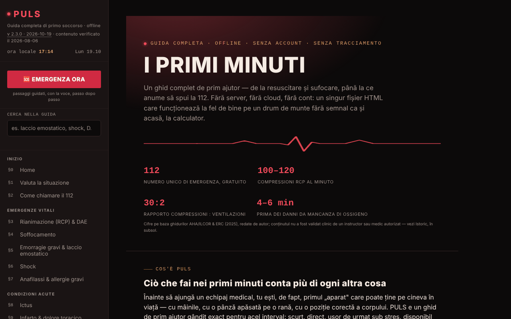

# PULS

[English](README.md) · [Română](README.ro.md) · [Français](README.fr.md) · **Italiano** · [Español](README.es.md) · [Português](README.pt.md) · [Deutsch](README.de.md) · [Magyar](README.hu.md)

**Versione:** 2.3.4 · **Ultimo aggiornamento:** 2026-10-22

Lingue dell'interfaccia: **Română, English, Français, Italiano, Español, Português (PT), Deutsch, Magyar**

Guida completa di primo soccorso, in un unico file HTML.

**App online:** https://chiuta.github.io/PULS/

## Che cos'è

PULS (v2.3.2 nell'applicazione, aggiornata il 2026-10-19; il contenuto medico è stato verificato l'ultima volta il 2026-08-06 e non è stato riverificato clinicamente) è una guida di primo soccorso in 8 lingue, con 32 sezioni e una «Modalità Emergenza» che ti guida passo dopo passo, con la voce, attraverso le manovre. Il contenuto è dichiarato educativo, redatto dall'autore sulla base delle linee guida ERC, AHA/ILCOR e OMS, **senza validazione clinica da parte di un istruttore o di un medico autorizzato**, e **non sostituisce** un corso autorizzato, il parere medico o l'intervento professionale; in una vera emergenza si chiama il 112.

**Lingue:** tutta la guida (passi, paragrafi, note, test di circa 96 domande, glossario, passi della Modalità Emergenza e guida vocale, cronologia, avvertenza), oltre al titolo e alla descrizione della pagina sono disponibili nelle 8 lingue; il testo esportato della scheda di emergenza (QR/PNG/stampa), il riepilogo del triage copiato, i dati che inserisci (comprese le righe «Allergie:/Farmaci:» e il messaggio personalizzato) e i nomi propri (TelVerde, 112, SMURD) restano invariati. Le traduzioni sono automatiche, non verificate da madrelingua; **tutti i contenuti medici tradotti (RCP/DAE, soffocamento, emorragia/laccio, shock, anafilassi, ictus, infarto, convulsioni, ipoglicemia, ipotermia, ustioni, intossicazioni, traumi, pediatria, primo soccorso psicologico, test, glossario, Modalità Emergenza) richiedono la revisione di un medico o di un istruttore autorizzato**, in particolare dosi e durate (aspirina 300 mg, 20 min di raffreddamento, 15–20 min di lavaggio degli occhi, 5–6 cm, 100–120/min); nella fonte «tabletă necoptă» è reso con «uncoated», probabilmente un errore da verificare. L'app non sostituisce un corso né la chiamata al 112.

## Funzioni

- **Sezioni (§0–§31):** valutazione della situazione, come chiamare il 112, RCP e DAE, soffocamento, emorragie ed emostatico (laccio), shock, anafilassi, ictus, infarto, convulsioni, ipoglicemia, ipotermia, colpo di calore, annegamento, intossicazioni, ustioni, folgorazione, fratture, traumi cranici, ferite, traumi oculari, morsi e punture, posizione laterale di sicurezza, cassetta di primo soccorso, la mia scheda di emergenza, triage, segnalazione di emergenza, primo soccorso pediatrico e psicologico, test di conoscenze, glossario A–Z.
- **🆘 EMERGENZA ORA:** modalità guidata, con passaggi e sintesi vocale (speechSynthesis del browser, dove disponibile).
- Metronomo RCP con suono e vibrazione, cronometro di avvicendamento dei soccorritori, feedback sul ritmo dall'accelerometro, cronometro del laccio emostatico.
- La mia scheda di emergenza (gruppo sanguigno, allergie, patologie, farmaci, contatto) con esportazione/importazione `.json` e generazione locale di codice QR; i dati personalizzano gli avvisi della Modalità Emergenza.
- Triage START con elenco delle vittime, segnalazione di emergenza (sirena, SOS in Morse, strobo, flash dove supportato), attivazione della Modalità Emergenza scuotendo il telefono (DeviceMotion).
- Pulsanti «Chiama il 112», «Invia la mia posizione» (geolocalizzazione + Web Share), «Ospedale più vicino».
- **Ricerca nella guida** (barra laterale): cerca nel testo integrale delle 32 sezioni, senza segni diacritici (es. «garou», «musc»), filtra il menu; Invio apre la sezione più pertinente, Esc svuota il campo.
- Test di conoscenze (fino a dieci domande per round), tema Notte/Giorno (alla prima apertura segue la preferenza di sistema «chiaro/scuro»), stampa della sezione corrente, pulsante «Segnala un errore» (mailto).

## Novità (v2.2.0, 14 ottobre 2026)

**Il contenuto medico (le 32 sezioni, i passaggi della Modalità Emergenza, i valori e gli avvisi) non è cambiato**; verificato automaticamente: il testo delle sezioni è identico a quello della v2.1.4, a eccezione di un pulsante aggiunto nel §25.

### Feedback aptico
- Vibrazioni brevi e distinte per le azioni dell'interfaccia nella Modalità Emergenza: apertura, scelta della situazione, passaggio successivo, passaggio precedente, ultimo passaggio, «La squadra è arrivata» e pressione di «Chiama il 112». Interruttore nel menu a sinistra e nella barra della Modalità Emergenza (📳); la scelta è conservata in `localStorage` (chiave `puls-haptic-v1`). Attivo per impostazione predefinita dove il browser offre `navigator.vibrate`; senza l'API, gli interruttori sono nascosti.
- Le vibrazioni **funzionali** esistenti (metronomo RCP, segnalazione SOS, avvisi dei cronometri) non dipendono da questo interruttore e sono rimaste invariate.
- **Limite:** iOS/Safari non offre la Vibration API, quindi lì non si percepisce nulla; su alcuni telefoni la vibrazione è disattivata nelle impostazioni di sistema.

### Scheda QR di emergenza a schermo intero
- Il pulsante «Scheda QR a schermo intero» (nel §25) apre una finestra con un grande codice QR (con zona di silenzio di 4 moduli, richiesta dai lettori) e con il testo della scheda sotto, in modo che possa essere letta anche senza scansione; può essere aperta anche dalla schermata «La squadra è arrivata». Manteniamo lo schermo acceso finché la finestra è aperta (dove esiste `Wake Lock`). Opzioni: salvataggio come PNG e stampa (solo la scheda).
- **Correzione:** la codifica QR usava Latin-1, quindi i segni diacritici rumeni (ă, ș, ț) venivano corrotti nel codice generato; ora il testo è codificato in UTF-8 (verificato decodificando con un lettore esterno). Anche il piccolo codice nella pagina ha ora una zona di silenzio e una dimensione maggiore.
- **Riservatezza:** il codice e il PNG contengono i dati della scheda **in chiaro**; chiunque scansioni l'immagine li legge. Tratta il file come un documento medico personale. Nulla lascia il browser.
- **Limite:** non c'è garanzia che ogni apparecchio legga il codice; la capacità del QR è limitata (campi molto lunghi possono superare la capacità e l'applicazione mostra un messaggio).

### Trasparenza e copia di riserva (fff-kit)

Un clic (o Invio) sulla versione mostrata (`v 2.2.0 · 2026-10-14`) apre la finestra «Trasparenza»: gli host di rete dichiarati (0 richieste esterne), le chiavi di archiviazione locale con le dimensioni, le API utilizzate, la dimensione e lo SHA-256 del file (con un verificatore per un file scaricato) e la **copia di riserva** dei dati dell'applicazione in un file `.fff.json` (facoltativamente cifrato con password, AES-GCM 256 / PBKDF2; la password non è recuperabile), l'importazione con conferma e la cancellazione dei dati dell'applicazione. Il kit (`fff-kit`, moduli: core, label, bundle) è incollato in `index.html`, non effettua richieste di rete e non modifica i dati esistenti; senza di esso l'applicazione funziona allo stesso modo. Attenzione: la copia di riserva del kit contiene, se hai spuntato la conservazione sul dispositivo, **anche la tua scheda di emergenza** (`puls-card-v1`, dati medici personali). Usa l'opzione «Esporta cifrato» se il file verrà archiviato o inviato. I testi del kit sono in 8 lingue (ro, en, fr, it, es, pt, hu, de); **le traduzioni fr/it/es/pt/hu/de sono automatiche e non verificate da madrelingua**. L'interfaccia e i contenuti dell'app sono disponibili anche nelle 8 lingue (vedi la nota sulle lingue in alto); le traduzioni dei contenuti sono automatiche, non verificate da madrelingua.

## Guida all'uso

1. Apri la pagina; naviga con il menu a sinistra (o ☰ su mobile).
2. In un'emergenza, premi **🆘 EMERGENZA ORA**, scegli la situazione e segui i passaggi («Passo successivo →», «← Indietro»). Il pulsante «📞 CHIAMA IL 112 ORA» avvia la chiamata. `Esc` chiude la modalità.
3. Per la RCP, apri il §3 e avvia il metronomo (suono/vibrazione); segui le indicazioni sullo schermo.
4. Nel §2, «📍 Invia la mia posizione» chiede il permesso di localizzazione; «🏥 Ospedale più vicino» apre la mappa del telefono.
5. Compila «La mia scheda di emergenza» (§25) finché sei calmo; «💾 Esporta (.json)» salva la scheda, «📂 Importa» la ripristina, «▦ Genera codice QR» crea un codice leggibile da qualsiasi lettore QR.
6. Cambia il tema con «☾ Notte» / «☀ Giorno»; «🖨️ Stampa la sezione corrente» stampa la sezione.
7. Esercitati con il §30 Test di conoscenze; cerca i termini nel §31 Glossario.

## Riservatezza e rete

- **Archiviazione locale:** l'unico uso di `localStorage` (chiave `puls-card-v1`) è la copia facoltativa della scheda di emergenza, attiva solo se spunti «Conserva la scheda su questo dispositivo»; senza la spunta, la scheda resta solo nella memoria della pagina (esportala in un file per non perderla). Nessuna chiamata a IndexedDB.
- **Archiviazione locale (aggiunta v2.2.0):** la chiave `puls-haptic-v1` conserva soltanto la scelta del feedback aptico (`0`/`1`).
- **Rete:** non esistono `fetch` né risorse caricate da altri siti; la libreria QR è inclusa nel file. Le uniche uscite dalla pagina sono link/azioni avviati dall'utente: Google Maps (`maps.google.com`, `google.com/maps`) per ospedale/farmacia e la posizione condivisa, la chiamata `tel:112`, `mailto:`, oltre a link verso fonti (crucearosie.ro, cpr.heart.org, erc.edu, who.int, smurd.ro, antisuicid.ro, buymeacoffee.com, trom.tf, chiuta.github.io).
- L'applicazione dichiara: nessun cookie, nessuna analisi.

## Esecuzione locale / offline

Scarica `index.html` e aprilo in un browser; la guida funziona senza internet. Solo i pulsanti di mappa/ospedale e la condivisione della posizione richiedono una connessione e le app del dispositivo.

## Licenza

MIT — vedi il file `LICENSE`. © 2026 Alexandru-Ionuț Chiuță (Alexio). Le librerie di terze parti incluse nel file mantengono le proprie licenze (per esempio il generatore di codici QR di Kazuhiko Arase, MIT).

## Audit

Audit: 2026-10-10 — verificato con Playwright e axe-core (WCAG 2.1 AA, entrambi i temi); verificato nel codice: nessun `fetch`, nessun `localStorage`. Corretti: il menu/layout per gli schermi stretti (mancavano le regole CSS per ☰), il contrasto dei colori. Il contenuto medico è stato solo esaminato, non validato clinicamente — per la verifica, chiedi il parere di uno specialista/istruttore autorizzato.

## Cronologia / Changelog
- 2.3.4 — 2026-10-22: fff-kit 1.1.2: PBKDF2 con 600.000 iterazioni, protezione anti-clickjacking
- 2.3.3 — 2026-10-22: Accessibilità: un solo H1 nella pagina (il titolo della home è un elemento di livello 2 annunciato come livello 1; l'aspetto è invariato). Mobile: tutto il testo arriva ad almeno 12 px; i link del piè di pagina e il pulsante «versioni precedenti» hanno un'area di tocco più grande; i pulsanti URGENZA sono alti almeno 44-48 px.
- 2.3.2 — 2026-10-19: tutta la guida, il test, il glossario, la Modalità Emergenza e la guida vocale sono tradotti in en, fr, it, es, pt, de, hu (circa 1.180 nuove chiavi); nella 2.3.2 anche il titolo e la meta descrizione della pagina seguono la lingua. La frase «resta in rumeno» è stata rimossa. Il contenuto medico richiede la revisione di un medico o di un istruttore autorizzato.
- 2.2.0 — 2026-10-14: feedback aptico facoltativo per i passaggi della Modalità Emergenza; scheda QR di emergenza a schermo intero (PNG, stampa); corretto il QR per i segni diacritici (UTF-8); fff-kit (Trasparenza + copia di riserva). Contenuto medico invariato.

- 2.1.4 — 2026-10-12: la versione e la data dell'ultimo aggiornamento sono mostrate nell'applicazione (contenuto medico invariato).

v2.1.3 (11 ottobre 2026):
- Barra superiore su mobile: il pulsante ☰ mostra ora anche il testo «Menu» (prima solo un'icona); il testo è nascosto sotto i 340 px.
- La mia scheda di emergenza: casella facoltativa «Conserva la scheda su questo dispositivo» (disattivata per impostazione predefinita; i dati vanno solo nel `localStorage` di questo browser, con avviso per i dispositivi condivisi; disattivandola si cancella la copia) e pulsante «Elimina la scheda». Senza la spunta, la scheda resta solo in memoria, come prima; l'esportazione/importazione `.json` è invariata.
- Hash CSP ricalcolati; axe-core = 0 violazioni a 1280 e 360 px.

v2.1.2 (11 ottobre 2026):
- Ricerca in tutta la guida nella barra laterale; il tema iniziale segue `prefers-color-scheme`; l'hero della prima sezione ha margini di 16 px sugli schermi ≤ 900 px (prima 44 px di padding interno, il testo restava largo ~240 px a 360 px). Hash CSP ricalcolato; axe-core = 0 violazioni a 1280 e 360 px, in entrambi i temi.

v2.1.1 (11 ottobre 2026):
- Margini laterali di 16 px sugli schermi ≤ 900 px (prima 44 px, che restringevano il testo a 360 px).
- Accessibilità: la barra superiore è un `<header>`, i titoli del piè di pagina sono h2 (ordine corretto); axe-core = 0 violazioni a 1280 e 360 px.
- Aggiunta una politica CSP (`<meta>`): script solo tramite hash, `connect-src 'none'`.
- La licenza resta non dichiarata (decisione dell'autore).

## Autore

Alexio — Alexandru-Ionuț Chiuță, contatto: alexio@trom.tf

## Riepilogo

PULS è una guida di primo soccorso in 8 lingue in un unico file HTML: 32 sezioni, una Modalità Emergenza guidata dalla voce, metronomo RCP, cronometro del laccio emostatico, scheda di emergenza con codice QR locale, triage START e segnalazione di emergenza. Nessuna chiamata fetch; localStorage solo se scegli di conservare la scheda di emergenza sul dispositivo; i pulsanti di mappa/ospedale aprono servizi esterni solo al clic. Contenuto educativo, non sostituisce una formazione certificata né la chiamata al numero di emergenza.
