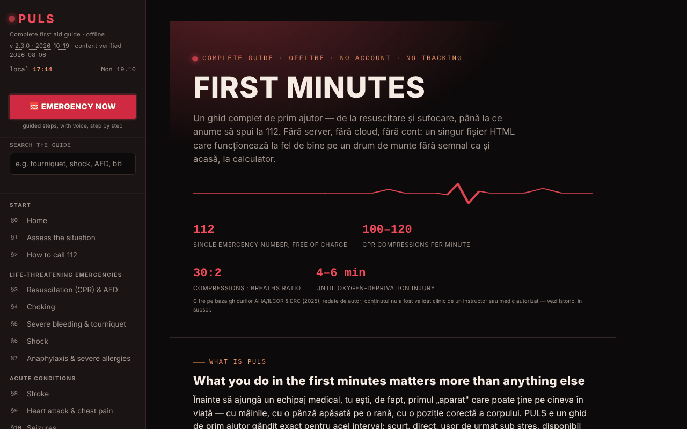

# PULS

**English** · [Română](README.ro.md) · [Français](README.fr.md) · [Italiano](README.it.md) · [Español](README.es.md) · [Português](README.pt.md) · [Deutsch](README.de.md) · [Magyar](README.hu.md)

**Version:** 2.4.0 · **Last updated:** 2026-10-27

**Status:** experimental (medical content not validated by a specialist) · **Offline:** complete after the first load; maps/location need internet

Interface languages: **Română, English, Français, Italiano, Español, Português (PT), Deutsch, Magyar**

A complete first-aid guide, in a single HTML file.

**Live app:** https://chiuta.github.io/PULS/

## What it is

PULS (v2.3.2 in the application, updated 2026-10-19; the medical content was last checked on 2026-08-06 and has not been clinically re-verified) is a first-aid guide in 8 languages, with 32 sections and an "Emergency Mode" that leads you step by step, by voice, through the manoeuvres. The content is declared educational, rendered by the author on the basis of the ERC, AHA/ILCOR and WHO guidelines, **without clinical validation by an authorized instructor or physician**, and it **does not replace** an authorized course, medical advice or professional intervention; in a real emergency, call 112.

**Languages:** the whole guide (steps, paragraphs, notes, the test of about 96 questions, glossary, the Emergency Mode steps and the voice guidance, history, disclaimer), as well as the page title and description are available in the 8 languages; the exported text of the emergency card (QR/PNG/print), the copied triage summary, the data you type in (including the "Allergies:/Medication:" lines and the custom message) and proper names (TelVerde, 112, SMURD) remain as they are. The translations are automatic and not verified by native speakers; **all the translated medical content (CPR/AED, choking, bleeding/tourniquet, shock, anaphylaxis, stroke, heart attack, seizures, hypoglycaemia, hypothermia, burns, poisoning, trauma, paediatrics, psychological first aid, test, glossary, Emergency Mode) needs review by a physician or an authorized instructor**, especially the doses and durations (aspirin 300 mg, 20 min cooling, 15–20 min eye rinsing, 5–6 cm, 100–120/min); the source has "tabletă necoptă" rendered as "uncoated", probably a mistake to be checked. The app does not replace a course or a call to 112.

## Features

- **Sections (§0–§31):** assessing the situation, how to call 112, CPR and AED, choking, bleeding and tourniquet, shock, anaphylaxis, stroke, heart attack, seizures, hypoglycaemia, hypothermia, heatstroke, drowning, poisoning, burns, electrocution, fractures, head injuries, wounds, eye injuries, bites and stings, recovery position, the first-aid kit, my emergency card, triage, emergency signalling, paediatric and psychological first aid, knowledge test, A–Z glossary.
- **🆘 EMERGENCY NOW:** guided mode, with steps and speech synthesis (the browser's speechSynthesis, where available).
- CPR metronome with sound and vibration, rescuer rotation timer, rhythm feedback from the accelerometer, tourniquet timer.
- My emergency card (blood group, allergies, conditions, medication, contact) with `.json` export/import and local QR code generation; the data personalizes the warnings in Emergency Mode.
- START triage with a casualty list, emergency signalling (siren, SOS Morse, strobe, flash where supported), activation of Emergency Mode by shaking the phone (DeviceMotion).
- Buttons "Call 112", "Send my location" (geolocation + Web Share), "Nearest hospital".
- **Search in the guide** (sidebar): searches the full text of the 32 sections, without diacritics (e.g. "garou", "musc"), filters the menu; Enter opens the best-matching section, Esc clears the field.
- Knowledge test (up to ten questions per round), Night/Day theme (on first opening it follows the system "light/dark" preference), printing of the current section, "Report an error" button (mailto).

## New features (v2.2.0, 14 October 2026)

**The medical content (the 32 sections, the steps in Emergency Mode, the values and the warnings) has not changed**; verified automatically: the text of the sections is identical to that in v2.1.4, except for one button added in §25.

### Haptic feedback
- Short, distinct vibrations on interface actions in Emergency Mode: opening, choosing the situation, next step, previous step, last step, "The crew has arrived" and pressing "Call 112". Toggle in the left-hand menu and in the Emergency Mode bar (📳); the choice is kept in `localStorage` (key `puls-haptic-v1`). On by default wherever the browser offers `navigator.vibrate`; without the API, the toggles are hidden.
- The existing **functional** vibrations (the CPR metronome, the SOS signalling, the timer alerts) do not depend on this toggle and have remained unchanged.
- **Limit:** iOS/Safari does not offer the Vibration API, so nothing is felt there; on some phones vibration is disabled in the system settings.

### Full-screen emergency QR card
- The button "Full-screen QR card" (in §25) opens a dialog with a large QR code (with a 4-module quiet zone, as required by readers) and the card's text below it, so that it can be read without scanning too; it can also be opened from the "The crew has arrived" screen. We keep the screen on while the dialog is open (where `Wake Lock` exists). Options: save as PNG and print (the card only).
- **Fix:** the QR encoding used Latin-1, so Romanian diacritics (ă, ș, ț) were corrupted in the generated code; the text is now encoded as UTF-8 (verified by decoding with an external reader). The small code on the page also now has a quiet zone and a larger size.
- **Privacy:** the code and the PNG contain the card's data **in clear text**; anyone who scans the image reads them. Treat the file as a personal medical document. Nothing leaves the browser.
- **Limit:** there is no guarantee that every device reads the code; QR capacity is limited (very long fields may exceed the capacity and the application shows a message).

### Transparency and backup (fff-kit)

One click (or Enter) on the displayed version (`v 2.2.0 · 2026-10-14`) opens the "Transparency" dialog: the declared network hosts (0 external requests), the local storage keys with sizes, the APIs used, the size and SHA-256 of the file (with a verifier for a downloaded file) and the **backup** of the application's data into a `.fff.json` file (optionally encrypted with a password, AES-GCM 256 / PBKDF2; the password cannot be recovered), import with confirmation, and deletion of the application's data. The kit (`fff-kit`, modules: core, label, bundle) is pasted into `index.html`, makes no network requests and does not change existing data; without it the application works the same. Note: the kit's backup contains, if you ticked keeping it on the device, **your emergency card as well** (`puls-card-v1`, personal medical data). Use the "Export encrypted" option if the file will be stored or sent. The kit's texts are in 8 languages (ro, en, fr, it, es, pt, hu, de); **the fr/it/es/pt/hu/de translations are machine-made and not native-checked**. The app's own interface and content are also available in the 8 languages (see the language note near the top); the content translations are automatic and not verified by native speakers.

## User guide

1. Open the page; navigate with the left-hand menu (or ☰ on mobile).
2. In an emergency, press **🆘 EMERGENCY NOW**, choose the situation and follow the steps ("Next step →", "← Back"). The button "📞 CALL 112 NOW" starts the call. `Esc` closes the mode.
3. For CPR, open §3 and start the metronome (sound/vibration); follow the on-screen instructions.
4. In §2, "📍 Send my location" asks for location permission; "🏥 Nearest hospital" opens the phone's map.
5. Fill in "My emergency card" (§25) while you are calm; "💾 Export (.json)" saves the card, "📂 Import" restores it, "▦ Generate QR code" creates a code readable by any QR reader.
6. Change the theme with "☾ Night" / "☀ Day"; "🖨️ Print the current section" prints the section.
7. Practise with §30 Knowledge test; look up terms in §31 Glossary.

## Privacy and network

- **Local storage:** the only use of `localStorage` (key `puls-card-v1`) is the optional copy of the emergency card, active only if you tick "Keep the card on this device"; without the tick, the card stays only in the page's memory (export it to a file so as not to lose it). No IndexedDB calls.
- **Local storage (v2.2.0 addition):** the key `puls-haptic-v1` stores only the haptic feedback choice (`0`/`1`).
- **Network:** there is no `fetch` or resource loaded from other sites; the QR library is included in the file. The only exits from the page are user-initiated links/actions: Google Maps (`maps.google.com`, `google.com/maps`) for hospital/pharmacy and the shared location, the `tel:112` call, `mailto:`, plus links to sources (crucearosie.ro, cpr.heart.org, erc.edu, who.int, smurd.ro, antisuicid.ro, buymeacoffee.com, trom.tf, chiuta.github.io).
- The application declares: no cookies, no analytics.

## Running locally / offline

Download `index.html` and open it in a browser; the guide works without internet. Only the map/hospital buttons and location sharing need a connection and the device's apps.

## License

MIT — see the `LICENSE` file. © 2026 Alexandru-Ionuț Chiuță (Alexio). Third-party libraries included in the file keep their own licenses (for example the QR code generator by Kazuhiko Arase, MIT).

## Audit

Audit: 2026-10-10 — verified with Playwright and axe-core (WCAG 2.1 AA, both themes); verified in code: no `fetch`, no `localStorage`. Fixed: the menu/layout for narrow screens (the CSS rules for ☰ were missing), colour contrast. The medical content was only reviewed, not clinically validated — for verification, ask for the opinion of an authorized specialist/instructor.

## Warning, offline check and what is missing (2026-10-27)

- **Permanent in-app warning (2.3.9):** a visible bar on all sections and a line in Emergency Mode state that "content is not validated by a specialist (physician or authorized instructor) — educational information; in an emergency, call 112", with a `tel:112` link. The medical text was **not modified**. **PULS is not validated by physicians, SMURD or the Red Cross** and does not claim to be; validation by a physician or authorized instructor remains the priority and **has not been done**.
- **Offline check (static, 2026-10-27):** `index.html` contains no `fetch`, `XMLHttpRequest`, `WebSocket`, `EventSource`, `sendBeacon`, `importScripts`, `@import`, `url(http…)`, nor `<script>`/`<link>`/`` pointing to external addresses; the CSP has `connect-src 'none'`. The only external addresses are links you open yourself (sources: crucearosie.ro, cpr.heart.org, erc.edu, who.int, smurd.ro, antisuicid.ro; Google Maps; `tel:`/`mailto:`) and licence comments of the QR library. **Conclusion:** the guide, the CPR metronome, the test and Emergency Mode work fully offline after the first load (service worker); only the map/hospital buttons and location sharing need the internet and the device's apps. Voice reading uses the browser's speech synthesis (some voices may be online, outside the app's control). This is a static check, not a test on devices.
- **CPR metronome:** already existed (sound + vibration, 100–120/min), together with the rescuer-rotation timer.
- **Illustrations for positions:** the recovery-position diagram (§23) and the compression-rate gauge exist; **additional illustrations for other positions/manoeuvres: planned, not implemented** (they would need to be drawn and validated by a specialist). The positions are described in text in their sections; the text was not modified.
- **External validation (physician, SMURD, Red Cross): not done.** This cannot be implemented in code; it remains a task for the author.

## 2.4.0: executable offline check (2026-10-27)

- The static offline check described in 2.3.9 is now a **repeatable test**: `tests/offline-static.test.mjs` (no browser) scans `index.html` and `sw.js` and fails if it finds `fetch`/`XMLHttpRequest`/`WebSocket`/`EventSource`/`sendBeacon`/`importScripts`/dynamic `import()` in the scripts, any external resource loaded automatically (`<script>`, `<link>`, ``, `<iframe>`, `@import`, `url(http…)`), a CSP that is not `default-src 'none'` / `connect-src 'none'` / hash-only `script-src`, an external host outside the known list of links you open yourself, an absolute URL or cross-origin handling in `sw.js`, or a missing "not validated by a specialist / call 112" warning in any of the 8 languages (34 checks; a mutation test confirmed it catches an injected `fetch`, an external stylesheet and a relaxed CSP).
- **It checks the code only**; it does not evaluate or change any medical content, and it is not a substitute for testing on real devices. Status stays **experimental**: **PULS is still not validated by physicians, SMURD or the Red Cross**.
- **Still planned, not implemented:** additional illustrations for other positions/manoeuvres (they would have to be drawn and validated by a specialist — not created here); validation by a physician or authorized instructor.

## History / Changelog

### 2.4.0 — 2026-10-27 (previous: 2.3.9)

Executable static offline check (`tests/offline-static.test.mjs`). No change to the app's behaviour or medical content.

### 2.3.9 — 2026-10-27 (previous: 2.3.8)

Permanent warning bar "content not validated by a specialist; call 112"; offline check documented. Medical content unchanged.

### 2.3.7 — 2026-10-23

Audit: emergency-card import now rejects files over 256 KB and non-object JSON (`null`, arrays) and resets the file field, so the same file can be re-imported. Medical content unchanged.

### 2.3.5 — 2026-10-22

fff-kit 1.1.4: touch targets and minimum text size; touch targets and text size corrected.
- 2.3.4 — 2026-10-22: fff-kit 1.1.2: PBKDF2 600,000 iterations, anti-clickjacking protection
- 2.3.3 — 2026-10-22: Accessibility: exactly one H1 in the page (the home title is now a level-2 element announced as level 1; the look is unchanged). Mobile: all text raised to at least 12 px; footer links and the "older versions" toggle have a larger tap area; the EMERGENCY buttons are at least 44-48 px tall.
- 2.3.2 — 2026-10-19: the whole guide, the test, the glossary, the Emergency Mode and the voice guidance are translated into en, fr, it, es, pt, de, hu (about 1,180 new keys); in 2.3.2 the page title and meta description also follow the language. The line "stays in Romanian" was removed. The medical content needs review by a physician or an authorized instructor.
- 2.2.0 — 2026-10-14: optional haptic feedback for the steps in Emergency Mode; full-screen emergency QR card (PNG, printing); fixed QR for diacritics (UTF-8); fff-kit (Transparency + backup). Medical content unchanged.

- 2.1.4 — 2026-10-12: the version and the date of the last update are shown in the application (medical content unchanged).

v2.1.3 (11 October 2026):
- Top bar on mobile: the ☰ button now also shows the text "Menu" (previously only an icon); the text is hidden below 340 px.
- My emergency card: optional box "Keep the card on this device" (off by default; the data goes only to this browser's `localStorage`, with a warning for shared devices; unticking deletes the copy) and a "Delete the card" button. Without the tick, the card stays only in memory, as before; the `.json` export/import is unchanged.
- CSP hashes recomputed; axe-core = 0 violations at 1280 and 360 px.

v2.1.2 (11 October 2026):
- Search across the whole guide in the sidebar; the initial theme follows `prefers-color-scheme`; the hero of the first section has 16 px margins on screens ≤ 900 px (previously 44 px of padding, the text stayed ~240 px wide at 360 px). CSP hash recomputed; axe-core = 0 violations at 1280 and 360 px, in both themes.

v2.1.1 (11 October 2026):
- Side margins of 16 px on screens ≤ 900 px (previously 44 px, which narrowed the text at 360 px).
- Accessibility: the top bar is a `<header>`, the footer headings are h2 (correct order); axe-core = 0 violations at 1280 and 360 px.
- Added a CSP policy (`<meta>`): scripts only by hash, `connect-src 'none'`.
- The license remains undeclared (the author's decision).

## Author

Alexio — Alexandru-Ionuț Chiuță, contact: alexio@trom.tf

## Summary

PULS is a 8-language first-aid guide in a single HTML file: 32 sections, a voice-guided Emergency Mode, CPR metronome, tourniquet timer, emergency card with local QR code, START triage and emergency signalling. No fetch calls; localStorage only if you opt in to keep the emergency card on the device; map/hospital buttons open external services only on click. Educational content, not a substitute for certified training or calling the emergency number.
