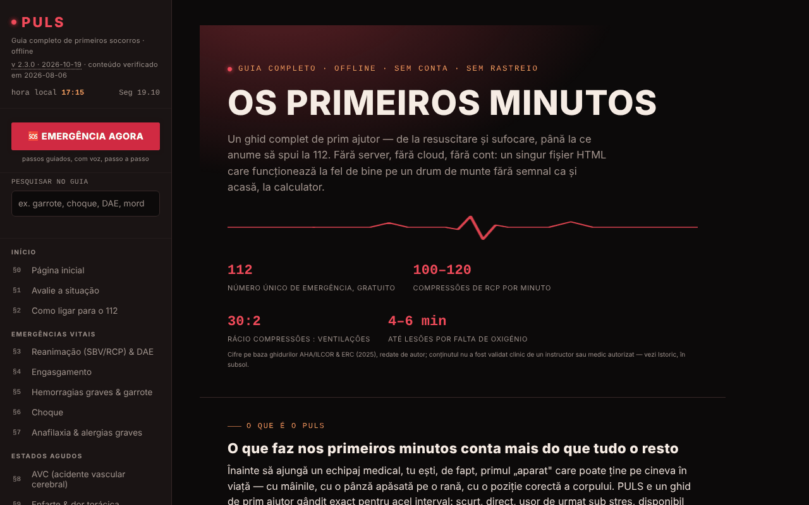

# PULS

[English](README.md) · [Română](README.ro.md) · [Français](README.fr.md) · [Italiano](README.it.md) · [Español](README.es.md) · **Português** · [Deutsch](README.de.md) · [Magyar](README.hu.md)

**Versão:** 2.3.2 · **Última atualização:** 2026-10-19

Idiomas da interface: **Română, English, Français, Italiano, Español, Português (PT), Deutsch, Magyar**

Guia completo de primeiros socorros, num único ficheiro HTML.

**Aplicação online:** https://chiuta.github.io/PULS/

## O que é

O PULS (v2.1.3 na aplicação, atualizada em 2026-10-11; o conteúdo médico foi verificado pela última vez em 2026-08-06 e não foi reverificado clinicamente) é um guia de primeiros socorros em romeno, com 32 secções e um «Modo Emergência» que o conduz passo a passo, por voz, através das manobras. O conteúdo é declarado educativo, redigido pelo autor com base nas diretrizes do ERC, da AHA/ILCOR e da OMS, **sem validação clínica por um formador ou médico autorizado**, e **não substitui** um curso autorizado, o parecer médico ou a intervenção profissional; numa emergência real, ligue 112.

## Funcionalidades

- **Secções (§0–§31):** avaliação da situação, como ligar para o 112, SBV/RCP e DAE, engasgamento, hemorragias e garrote, choque, anafilaxia, AVC, enfarte, convulsões, hipoglicemia, hipotermia, golpe de calor, afogamento, intoxicações, queimaduras, eletrocussão, fraturas, traumatismos crânio-encefálicos, feridas, traumatismos oculares, mordeduras e picadas, posição lateral de segurança, caixa de primeiros socorros, o meu cartão de emergência, triagem, sinalização de emergência, primeiros socorros pediátricos e psicológicos, teste de conhecimentos, glossário A–Z.
- **🆘 EMERGÊNCIA AGORA:** modo guiado, com passos e síntese de voz (speechSynthesis do navegador, onde existir).
- Metrónomo de RCP com som e vibração, cronómetro de rotação dos socorristas, feedback do ritmo a partir do acelerómetro, cronómetro do garrote.
- O meu cartão de emergência (grupo sanguíneo, alergias, doenças, medicação, contacto) com exportação/importação `.json` e geração local de código QR; os dados personalizam os avisos do Modo Emergência.
- Triagem START com lista de vítimas, sinalização de emergência (sirene, SOS em Morse, estroboscópio, flash onde suportado), ativação do Modo Emergência abanando o telemóvel (DeviceMotion).
- Botões «Ligar 112», «Enviar a minha localização» (geolocalização + Web Share), «Hospital mais próximo».
- **Pesquisa no guia** (barra lateral): pesquisa no texto integral das 32 secções, sem diacríticos (p. ex. «garou», «musc»), filtra o menu; Enter abre a secção mais adequada, Esc limpa o campo.
- Teste de conhecimentos (até dez perguntas por ronda), tema Noite/Dia (na primeira abertura segue a preferência do sistema «claro/escuro»), impressão da secção atual, botão «Comunicar um erro» (mailto).

## Novidades (v2.2.0, 14 de outubro de 2026)

**O conteúdo médico (as 32 secções, os passos do Modo Emergência, os valores e os avisos) não mudou**; verificado automaticamente: o texto das secções é idêntico ao da v2.1.4, exceto um botão adicionado no §25.

### Feedback háptico
- Vibrações curtas e distintas nas ações de interface do Modo Emergência: abertura, escolha da situação, passo seguinte, passo anterior, último passo, «A equipa chegou» e premir «Ligar 112». Comutador no menu à esquerda e na barra do Modo Emergência (📳); a escolha é guardada em `localStorage` (chave `puls-haptic-v1`). Ativado por predefinição onde o navegador oferece `navigator.vibrate`; sem a API, os comutadores ficam ocultos.
- As vibrações **funcionais** existentes (metrónomo de RCP, sinalização SOS, alertas dos cronómetros) não dependem deste comutador e permaneceram inalteradas.
- **Limite:** o iOS/Safari não oferece a API de vibração, pelo que aí não se sente nada; em alguns telemóveis a vibração está desativada nas definições do sistema.

### Cartão QR de emergência em ecrã inteiro
- O botão «Cartão QR em ecrã inteiro» (no §25) abre uma caixa de diálogo com um código QR grande (com zona de silêncio de 4 módulos, exigida pelos leitores) e com o texto do cartão por baixo, para que também possa ser lido sem digitalização; também pode ser aberto a partir do ecrã «A equipa chegou». Mantemos o ecrã ligado enquanto a caixa de diálogo está aberta (onde existe `Wake Lock`). Opções: guardar como PNG e imprimir (apenas o cartão).
- **Correção:** a codificação do QR usava Latin-1, pelo que os diacríticos romenos (ă, ș, ț) ficavam corrompidos no código gerado; agora o texto é codificado em UTF-8 (verificado por descodificação com um leitor externo). Também o código pequeno da página tem agora zona de silêncio e um tamanho maior.
- **Privacidade:** o código e o PNG contêm os dados do cartão **em claro**; qualquer pessoa que digitalize a imagem lê-os. Trate o ficheiro como um documento médico pessoal. Nada sai do navegador.
- **Limite:** não há garantia de que qualquer aparelho leia o código; a capacidade do QR é limitada (campos muito longos podem exceder a capacidade e a aplicação mostra uma mensagem).

### Transparência e cópia de segurança (fff-kit)

Um clique (ou Enter) na versão apresentada (`v 2.2.0 · 2026-10-14`) abre a janela «Transparência»: os anfitriões de rede declarados (0 pedidos externos), as chaves de armazenamento local com os tamanhos, as API utilizadas, o tamanho e o SHA-256 do ficheiro (com um verificador para um ficheiro descarregado) e a **cópia de segurança** dos dados da aplicação num ficheiro `.fff.json` (opcionalmente cifrado com palavra-passe, AES-GCM 256 / PBKDF2; a palavra-passe não pode ser recuperada), a importação com confirmação e o apagamento dos dados da aplicação. O kit (`fff-kit`, módulos: core, label, bundle) está colado em `index.html`, não faz pedidos de rede e não altera os dados existentes; sem ele a aplicação funciona da mesma forma. Atenção: a cópia de segurança do kit contém, se tiver marcado a conservação no dispositivo, **também o seu cartão de emergência** (`puls-card-v1`, dados médicos pessoais). Use a opção «Exportar cifrado» se o ficheiro for armazenado ou enviado. Os textos do kit estão em 8 idiomas (ro, en, fr, it, es, pt, hu, de); **as traduções fr/it/es/pt/hu/de são automáticas e não foram verificadas por falantes nativos**. A interface da própria aplicação permanece em romeno.

## Manual de utilização

1. Abra a página; navegue com o menu à esquerda (ou ☰ no telemóvel).
2. Numa emergência, prima **🆘 EMERGÊNCIA AGORA**, escolha a situação e siga os passos («Passo seguinte →», «← Voltar»). O botão «📞 LIGAR 112 AGORA» inicia a chamada. `Esc` fecha o modo.
3. Para a RCP, abra o §3 e inicie o metrónomo (som/vibração); siga as indicações no ecrã.
4. No §2, «📍 Enviar a minha localização» pede permissão de localização; «🏥 Hospital mais próximo» abre o mapa do telemóvel.
5. Preencha «O meu cartão de emergência» (§25) enquanto está calmo; «💾 Exportar (.json)» guarda o cartão, «📂 Importar» restaura-o, «▦ Gerar código QR» cria um código legível por qualquer leitor de QR.
6. Mude o tema com «☾ Noite» / «☀ Dia»; «🖨️ Imprimir a secção atual» imprime a secção.
7. Pratique com o §30 Teste de conhecimentos; procure termos no §31 Glossário.

## Privacidade e rede

- **Armazenamento local:** a única utilização de `localStorage` (chave `puls-card-v1`) é a cópia opcional do cartão de emergência, ativa apenas se marcar «Guardar o cartão neste dispositivo»; sem a marca, o cartão fica apenas na memória da página (exporte-o para um ficheiro para não o perder). Nenhuma chamada a IndexedDB.
- **Armazenamento local (adição v2.2.0):** a chave `puls-haptic-v1` guarda apenas a escolha do feedback háptico (`0`/`1`).
- **Rede:** não existem `fetch` nem recursos carregados de outros sítios; a biblioteca QR está incluída no ficheiro. As únicas saídas da página são ligações/ações iniciadas pelo utilizador: Google Maps (`maps.google.com`, `google.com/maps`) para hospital/farmácia e a localização partilhada, a chamada `tel:112`, `mailto:`, além de ligações para fontes (crucearosie.ro, cpr.heart.org, erc.edu, who.int, smurd.ro, antisuicid.ro, buymeacoffee.com, trom.tf, chiuta.github.io).
- A aplicação declara: sem cookies, sem análise.

## Execução local / offline

Descarregue `index.html` e abra-o num navegador; o guia funciona sem internet. Apenas os botões de mapa/hospital e a partilha da localização precisam de ligação e das aplicações do dispositivo.

## Licença

MIT — veja o ficheiro `LICENSE`. © 2026 Alexandru-Ionuț Chiuță (Alexio). As bibliotecas de terceiros incluídas no ficheiro mantêm as suas próprias licenças (por exemplo, o gerador de códigos QR de Kazuhiko Arase, MIT).

## Auditoria

Auditoria: 2026-10-10 — verificado com Playwright e axe-core (WCAG 2.1 AA, ambos os temas); verificado no código: sem `fetch`, sem `localStorage`. Corrigidos: o menu/disposição para ecrãs estreitos (faltavam as regras CSS para ☰), o contraste das cores. O conteúdo médico foi apenas percorrido, não validado clinicamente — para verificação, peça o parecer de um especialista/formador autorizado.

## Histórico / Registo de alterações
- 2.2.0 — 2026-10-14: feedback háptico opcional para os passos do Modo Emergência; cartão QR de emergência em ecrã inteiro (PNG, impressão); QR corrigido para diacríticos (UTF-8); fff-kit (Transparência + cópia de segurança). Conteúdo médico inalterado.

- 2.1.4 — 2026-10-12: a versão e a data da última atualização são mostradas na aplicação (conteúdo médico inalterado).

v2.1.3 (11 de outubro de 2026):
- Barra superior no telemóvel: o botão ☰ mostra agora também o texto «Menu» (antes só um ícone); o texto fica oculto abaixo de 340 px.
- O meu cartão de emergência: caixa opcional «Guardar o cartão neste dispositivo» (desativada por predefinição; os dados vão apenas para o `localStorage` deste navegador, com aviso para dispositivos partilhados; desmarcá-la apaga a cópia) e botão «Apagar o cartão». Sem a marca, o cartão fica apenas em memória, como até agora; a exportação/importação `.json` não muda.
- Hashes CSP recalculados; axe-core = 0 violações a 1280 e 360 px.

v2.1.2 (11 de outubro de 2026):
- Pesquisa em todo o guia na barra lateral; o tema inicial segue `prefers-color-scheme`; o hero da primeira secção tem margens de 16 px em ecrãs ≤ 900 px (antes 44 px de preenchimento interno, o texto ficava com cerca de 240 px de largura a 360 px). Hash CSP recalculado; axe-core = 0 violações a 1280 e 360 px, em ambos os temas.

v2.1.1 (11 de outubro de 2026):
- Margens laterais de 16 px em ecrãs ≤ 900 px (antes 44 px, o que estreitava o texto a 360 px).
- Acessibilidade: a barra superior é um `<header>`, os títulos do rodapé são h2 (ordem correta); axe-core = 0 violações a 1280 e 360 px.
- Adicionada uma política CSP (`<meta>`): scripts apenas por hash, `connect-src 'none'`.
- A licença permanece por declarar (decisão do autor).

## Autor

Alexio — Alexandru-Ionuț Chiuță, contacto: alexio@trom.tf

## Resumo

O PULS é um guia de primeiros socorros em romeno num único ficheiro HTML: 32 secções, um Modo Emergência guiado por voz, metrónomo de RCP, cronómetro de garrote, cartão de emergência com código QR local, triagem START e sinalização de emergência. Sem chamadas fetch; localStorage apenas se optar por guardar o cartão de emergência no dispositivo; os botões de mapa/hospital só abrem serviços externos ao clicar. Conteúdo educativo, não substitui uma formação certificada nem a chamada para o número de emergência.
