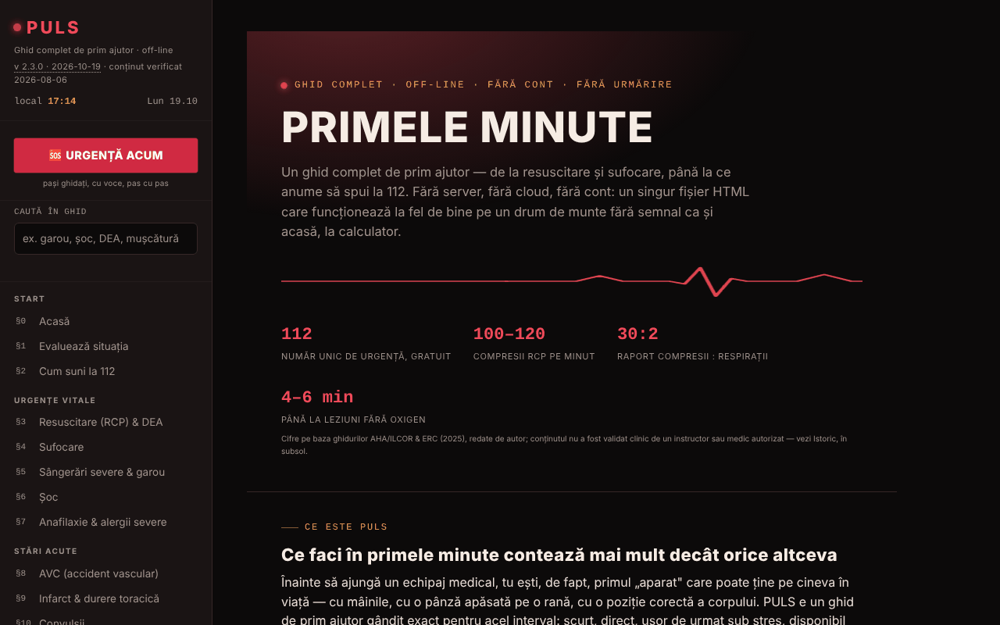

# PULS

[English](README.md) · **Română** · [Français](README.fr.md) · [Italiano](README.it.md) · [Español](README.es.md) · [Português](README.pt.md) · [Deutsch](README.de.md) · [Magyar](README.hu.md)

**Versiune:** 2.3.8 · **Ultima actualizare:** 2026-10-26

Limbile interfeței: **Română, English, Français, Italiano, Español, Português (PT), Deutsch, Magyar**

Ghid complet de prim ajutor, într-un singur fișier HTML.

**Live:** https://chiuta.github.io/PULS/

## Ce este

PULS (v2.3.2 în aplicație, actualizat 2026-10-19; conținutul medical a fost verificat ultima dată la 2026-08-06 și nu a fost reverificat clinic) este un ghid de prim ajutor în 8 limbi, cu 32 de secțiuni și un „Mod Urgență” care te conduce pas cu pas, cu voce, prin manevre. Conținutul este declarat educațional, redat de autor pe baza ghidurilor ERC, AHA/ILCOR și OMS, **fără validare clinică de către un instructor sau medic autorizat**, și **nu înlocuiește** un curs autorizat, avizul medical sau intervenția profesională; în urgență reală se sună la 112.

**Limbi:** tot ghidul (pași, paragrafe, note, testul de circa 96 de întrebări, glosar, pașii din Modul Urgență și ghidarea vocală, istoric, disclaimer), precum și titlul și descrierea paginii sunt disponibile în cele 8 limbi; textul exportat al cardului de urgență (QR/PNG/tipărire), rezumatul de triaj copiat, datele pe care le introduci (inclusiv liniile „Alergii:/Medicație:” și mesajul personalizat) și numele proprii (TelVerde, 112, SMURD) rămân neschimbate. Traducerile sunt automate, neverificate de vorbitori nativi; **tot conținutul medical tradus (RCP/DEA, sufocare, sângerări/garou, șoc, anafilaxie, AVC, infarct, convulsii, hipoglicemie, hipotermie, arsuri, intoxicații, traumatisme, pediatrie, prim ajutor psihologic, test, glosar, Modul Urgență) necesită revizie de către un medic sau un instructor autorizat**, în special dozele și duratele (aspirină 300 mg, 20 min de răcire, 15–20 min clătirea ochilor, 5–6 cm, 100–120/min); în sursă „tabletă necoptă” a fost tradusă „uncoated”, probabil o greșeală de verificat. Aplicația nu înlocuiește un curs sau apelul la 112.

## Funcții

- **Secțiuni (§0–§31):** evaluarea situației, cum suni la 112, RCP și DEA, sufocare, sângerări și garou, șoc, anafilaxie, AVC, infarct, convulsii, hipoglicemie, hipotermie, insolație, înec, intoxicații, arsuri, electrocutare, fracturi, traumatisme cranio-cerebrale, plăgi, traumatisme oculare, mușcături și înțepături, poziția de siguranță, trusa de prim ajutor, cardul meu de urgență, triaj, semnalizare de urgență, prim ajutor pediatric și psihologic, test de cunoștințe, glosar A–Z.
- **🆘 URGENȚĂ ACUM:** mod ghidat, cu pași și sinteză vocală (speechSynthesis din browser, acolo unde există).
- Metronom RCP cu sunet și vibrație, cronometru de rotație a salvatorilor, feedback de ritm din accelerometru, cronometru de garou.
- Cardul meu de urgență (grupă sanguină, alergii, afecțiuni, medicație, contact) cu export/import `.json` și generare de cod QR local; datele personalizează avertismentele din Mod Urgență.
- Triaj START cu listă de victime, semnalizare de urgență (sirenă, SOS Morse, strobe, bliț unde e suportat), activare Mod Urgență prin scuturarea telefonului (DeviceMotion).
- Butoane „Sună 112”, „Trimite locația mea” (geolocalizare + Web Share), „Cel mai apropiat spital”.
- **Căutare în ghid** (sidebar): caută în textul integral al celor 32 de secțiuni, fără diacritice (ex. „garou”, „musc”), filtrează meniul; Enter deschide secțiunea cea mai potrivită, Esc golește câmpul.
- Test de cunoștințe (până la zece întrebări pe rundă), tema Noapte/Zi (la prima deschidere urmează preferința de sistem „lumină/întuneric”), tipărirea secțiunii curente, buton „Raportează o eroare” (mailto).

## Funcții noi (v2.2.0, 14 octombrie 2026)

**Conținutul medical (cele 32 de secțiuni, pașii din Mod Urgență, valorile și avertismentele) nu s-a schimbat**; verificat automat: textul secțiunilor este identic cu cel din v2.1.4, cu excepția unui buton adăugat în §25.

### Feedback haptic
- Vibrații scurte, distincte, la acțiunile de interfață din Mod Urgență: deschidere, alegerea situației, pasul următor, pasul înapoi, ultimul pas, „A ajuns echipajul” și apăsarea „Sună 112”. Comutator în meniul din stânga și în bara Modului Urgență (📳); alegerea se păstrează în `localStorage` (cheia `puls-haptic-v1`). Implicit pornit acolo unde browserul oferă `navigator.vibrate`; fără API, comutatoarele sunt ascunse.
- Vibrațiile **funcționale** existente (metronomul RCP, semnalizarea SOS, alertele cronometrelor) nu depind de acest comutator și au rămas neschimbate.
- **Limită:** iOS/Safari nu oferă Vibration API, deci acolo nu se simte nimic; pe unele telefoane vibrația e dezactivată din setările sistemului.

### Card QR de urgență pe tot ecranul
- Butonul „Card QR pe tot ecranul” (în §25) deschide un dialog cu un cod QR mare (cu zonă liberă de 4 module, cerută de cititoare) și cu textul cardului dedesubt, ca să poată fi citit și fără scanare; mai poate fi deschis din ecranul „A ajuns echipajul”. Ținem ecranul aprins cât dialogul e deschis (unde `Wake Lock` există). Opțiuni: salvare PNG și tipărire (doar cardul).
- **Reparație:** codarea QR folosea Latin-1, deci diacriticele românești (ă, ș, ț) se stricau în codul generat; acum textul este codat UTF-8 (verificat prin decodare cu un cititor extern). Și codul mic din pagină are acum zonă liberă și o dimensiune mai mare.
- **Confidențialitate:** codul și PNG-ul conțin datele cardului **în clar**; oricine scanează imaginea le citește. Tratează fișierul ca pe un document medical personal. Nimic nu pleacă din browser.
- **Limită:** nu există garanția că orice aparat citește codul; capacitatea QR e limitată (câmpuri foarte lungi pot depăși capacitatea și aplicația afișează un mesaj).

### Transparență și copie de siguranță (fff-kit)

Un clic (sau Enter) pe versiunea afișată (`v 2.2.0 · 2026-10-14`) deschide fereastra „Transparență”: gazdele de rețea declarate (0 cereri externe), cheile de stocare locală cu dimensiuni, API-urile folosite, mărimea și SHA-256 al fișierului (cu verificator pentru un fișier descărcat) și **copia de siguranță** a datelor aplicației într-un fișier `.fff.json` (opțional criptat cu parolă, AES-GCM 256 / PBKDF2; parola nu poate fi recuperată), import cu confirmare și ștergerea datelor aplicației. Kitul (`fff-kit`, module: core, label, bundle) este lipit în `index.html`, nu face cereri de rețea și nu schimbă datele existente; fără el aplicația funcționează la fel. Atenție: copia de siguranță a kitului conține, dacă ai bifat păstrarea pe dispozitiv, **și cardul tău de urgență** (`puls-card-v1`, date medicale personale). Folosește opțiunea „Exportă criptat” dacă fișierul va fi stocat sau trimis. Textele kitului sunt în 8 limbi (ro, en, fr, it, es, pt, hu, de); **traducerile fr/it/es/pt/hu/de sunt automate și neverificate nativ**. Interfața și conținutul aplicației sunt disponibile și în cele 8 limbi (vezi nota despre limbi de la început); traducerile conținutului sunt automate, neverificate de vorbitori nativi.

## Manual de utilizare

1. Deschide pagina; navighează cu meniul din stânga (sau ☰ pe mobil).
2. Într-o urgență, apasă **🆘 URGENȚĂ ACUM**, alege situația și urmează pașii („Următorul pas →”, „← Înapoi”). Butonul „📞 SUNĂ 112 ACUM” inițiază apelul. `Esc` închide modul.
3. Pentru RCP, deschide §3 și pornește metronomul (sunet/vibrație); respectă indicațiile pe ecran.
4. În §2, „📍 Trimite locația mea” cere permisiunea de locație; „🏥 Cel mai apropiat spital” deschide harta telefonului.
5. Completează „Cardul meu de urgență” (§25) cât ești calm; „💾 Exportă (.json)” salvează cardul, „📂 Importă” îl restaurează, „▦ Generează cod QR” creează un cod citibil de orice cititor QR.
6. Schimbă tema cu „☾ Noapte” / „☀ Zi”; „🖨️ Printează secțiunea curentă” tipărește secțiunea.
7. Exersează cu §30 Test de cunoștințe; caută termeni în §31 Glosar.

## Confidențialitate și rețea

- **Stocare locală:** singura utilizare a `localStorage` (cheia `puls-card-v1`) este copia opțională a cardului de urgență, activă doar dacă bifezi „Păstrează cardul pe acest dispozitiv”; fără bifă, cardul rămâne doar în memoria paginii (exportă-l în fișier ca să nu-l pierzi). Niciun apel IndexedDB.
- **Stocare locală (adăugire v2.2.0):** cheia `puls-haptic-v1` păstrează doar alegerea feedbackului haptic (`0`/`1`).
- **Rețea:** nu există `fetch` sau resurse încărcate de pe alte site-uri; biblioteca QR este inclusă în fișier. Singurele ieșiri din pagină sunt linkuri/acțiuni inițiate de utilizator: harta Google (`maps.google.com`, `google.com/maps`) pentru spital/farmacie și locația partajată, apelul `tel:112`, `mailto:`, plus linkuri către surse (crucearosie.ro, cpr.heart.org, erc.edu, who.int, smurd.ro, antisuicid.ro, buymeacoffee.com, trom.tf, chiuta.github.io).
- Aplicația declară: fără cookie-uri, fără analytics.

## Rulare locală / offline

Descarcă `index.html` și deschide-l în browser; ghidul funcționează fără internet. Doar butoanele de hartă/spital și partajarea locației au nevoie de conexiune și de aplicații ale dispozitivului.

## Licență

MIT — vezi fișierul `LICENSE`. © 2026 Alexandru-Ionuț Chiuță (Alexio). Bibliotecile terțe incluse în fișier își păstrează licențele proprii (de exemplu generatorul de coduri QR de Kazuhiko Arase, MIT).

## Audit

Audit: 2026-10-10 — verificat cu Playwright și axe-core (WCAG 2.1 AA, ambele teme); verificat în cod: fără `fetch`, fără `localStorage`. Corectate: meniul/layoutul pentru ecrane înguste (regulile CSS pentru ☰ lipseau), contrastul culorilor. Conținutul medical a fost doar parcurs, nu validat clinic — pentru verificare cere avizul unui specialist/instructor autorizat.

## Istoric / Changelog

### 2.3.7 — 2026-10-23

Audit: importul cardului de urgență respinge fișierele peste 256 KB și JSON-ul care nu e obiect (`null`, liste) și resetează câmpul de fișier, astfel încât același fișier poate fi reimportat. Conținutul medical este neschimbat.

### 2.3.5 — 2026-10-22

fff-kit 1.1.4: ținte tactile și text minim; ținte tactile/text corectate.
- 2.3.4 — 2026-10-22: fff-kit 1.1.2: PBKDF2 600 000 iterații, protecție anti-clickjacking
- 2.3.3 — 2026-10-22: Accesibilitate: exact un singur H1 în pagină (titlul de pe prima pagină e acum un element de nivel 2 anunțat ca nivel 1; aspectul e neschimbat). Mobil: tot textul are minimum 12 px; linkurile din subsol și comutatorul „versiuni mai vechi” au o zonă de atingere mai mare; butoanele URGENȚĂ au cel puțin 44-48 px înălțime.
- 2.3.2 — 2026-10-19: tot ghidul, testul, glosarul, Modul Urgență și ghidarea vocală sunt traduse în en, fr, it, es, pt, de, hu (circa 1.180 de chei noi); în 2.3.2 și titlul și meta descrierea paginii urmează limba. Fraza „rămâne în română” a fost eliminată. Conținutul medical necesită revizie de către un medic sau un instructor autorizat.
- 2.2.0 — 2026-10-14: feedback haptic opțional pentru pașii din Mod Urgență; card QR de urgență pe tot ecranul (PNG, tipărire); reparat QR pentru diacritice (UTF-8); kit fff-kit (Transparență + copie de siguranță). Conținutul medical neschimbat.

- 2.1.4 — 2026-10-12: versiunea și data ultimei actualizări sunt afișate în aplicație (conținutul medical neschimbat).

v2.1.3 (11 octombrie 2026):
- Bara de sus pe mobil: butonul ☰ arată acum și textul „Meniu” (înainte doar o pictogramă); textul se ascunde sub 340 px.
- Cardul meu de urgență: casetă opțională „Păstrează cardul pe acest dispozitiv” (implicit dezactivată; datele merg doar în `localStorage` al acestui browser, cu avertisment pentru dispozitive comune; debifarea șterge copia) și buton „Șterge cardul”. Fără bifă, cardul rămâne doar în memorie, ca până acum; exportul/importul `.json` neschimbat.
- Hash-urile CSP recalculate; axe-core = 0 violări la 1280 și 360 px.

v2.1.2 (11 octombrie 2026):
- Căutare în tot ghidul din sidebar; tema inițială urmează `prefers-color-scheme`; hero-ul primei secțiuni are margini de 16 px pe ecrane ≤ 900 px (înainte 44 px interni, textul rămânea ~240 px lat pe 360 px). Hash-ul CSP recalculat; axe-core = 0 violări la 1280 și 360 px, în ambele teme.

v2.1.1 (11 octombrie 2026):
- Margini laterale de 16 px pe ecrane ≤ 900 px (înainte 44 px, care îngusta textul pe 360 px).
- Accesibilitate: bara de sus este `<header>`, titlurile din subsol sunt h2 (ordine corectă); axe-core = 0 violări la 1280 și 360 px.
- Adăugată politică CSP (`<meta>`): scripturi doar pe bază de hash, `connect-src 'none'`.
- Licența rămâne nedeclarată (decizie a autorului).

## Autor

Alexio — Alexandru-Ionuț Chiuță, contact: alexio@trom.tf

## Rezumat

PULS este un ghid de prim ajutor în 8 limbi, într-un singur fișier HTML: 32 de secțiuni, un Mod Urgență ghidat vocal, metronom RCP, cronometru pentru garou, card de urgență cu cod QR local, triaj START și semnalizare de urgență. Fără apeluri fetch; localStorage doar dacă alegi să păstrezi cardul de urgență pe dispozitiv; butoanele de hartă/spital deschid servicii externe doar la clic. Conținut educațional, nu înlocuiește instruirea certificată sau apelarea numărului de urgență.
